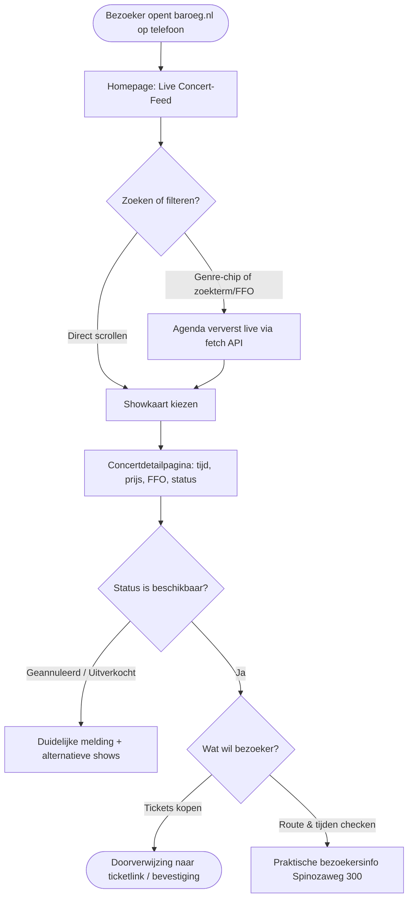
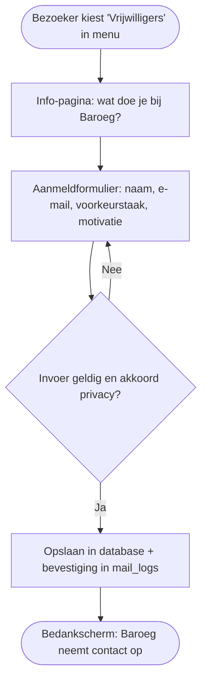
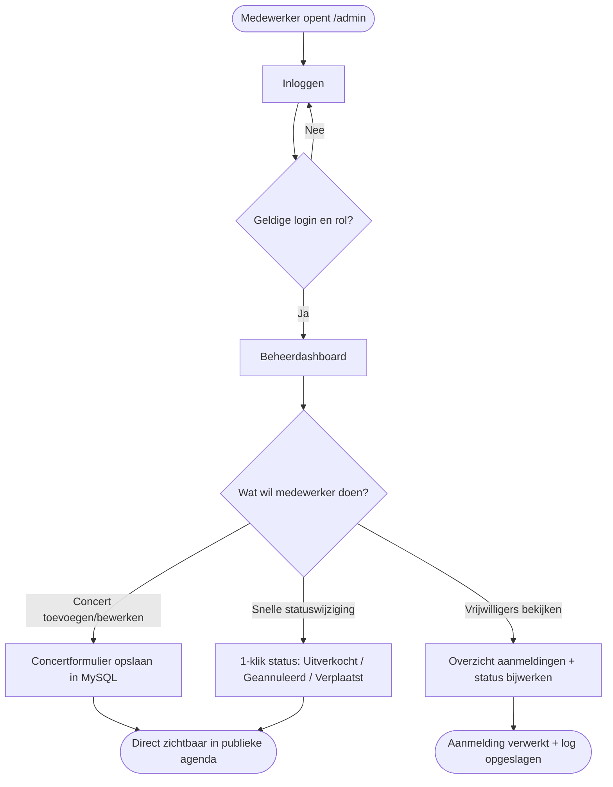
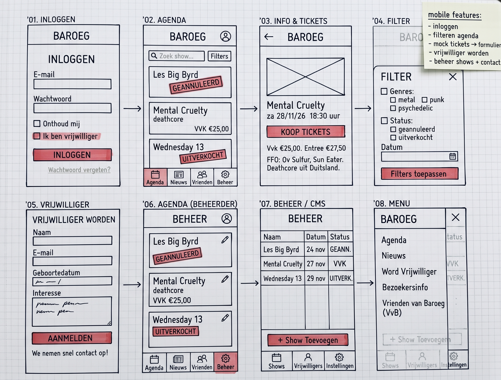
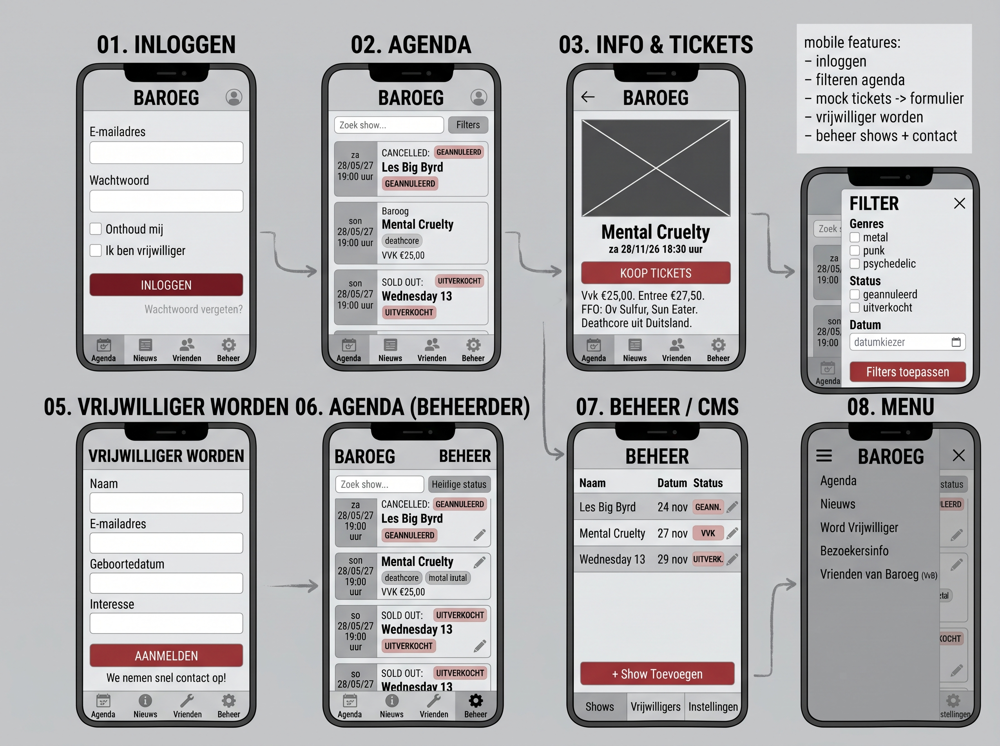
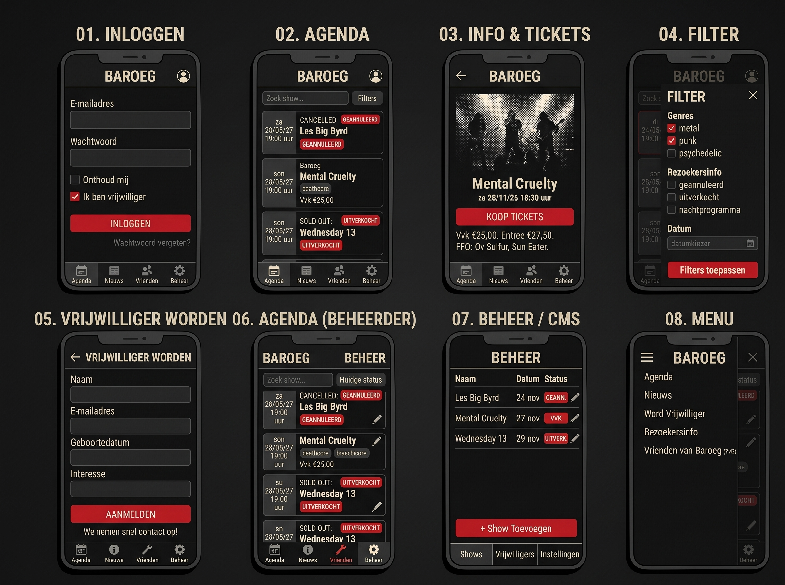

# Projectplan: Poppodium Baroeg (Mobile-First Website)

| | |
|---|---|
| Project | Vernieuwing website Poppodium Baroeg (2026#301) |
| Opdrachtgever | Poppodium Baroeg Rotterdam (potentiële klantcase) |
| Team | *In te vullen door het projectteam* |

> **Let op:** dit is een eerste opzet en voorbeeldplan. Er heeft nog geen officiële intake met Baroeg plaatsgevonden. De inhoud is gebaseerd op een analyse van de huidige website (`baroeg.nl`) en de namen en onderzoekscijfers in hoofdstuk 1 zijn verzonnen om te laten zien hoe een onderbouwd plan volgens *Design Thinking* eruitziet. Jullie team gebruikt dit plan als vertrekpunt en pitcht in week 2 of 3 jullie aangescherpte, definitieve versie aan de opdrachtgever/docent.

In dit plan geven we elk inzicht, elke eis en elke test een code (zoals **I1**, **E1**, **T1**). Zo kun je altijd terugzien waar een ontwerp- of techniekkeuze vandaan komt.

---

## Debriefing: wat is de opdracht?

### Achtergrond

Poppodium Baroeg (Spinozaweg 300, Rotterdam) is sinds 1981 hét Rotterdamse podium voor harde en alternatieve muziek, met stijlen als metal, punk, hardcore, rock, industrial, synthwave, gothic en drum 'n bass. In april 2026 heeft Baroeg een gloednieuw pand geopend aan de Spinozaweg. De huidige website (`baroeg.nl`) past qua overzichtelijkheid en mobiele gebruiksvriendelijkheid echter niet meer bij deze nieuwe start: het hoofdmenu bevat meer dan 30 submenu-items en bezoekers op een telefoon moeten lang scrollen door de agenda om een passende show, actuele status of praktische bezoekersinformatie te vinden.

### De vraag van de opdrachtgever

Ontwerp en bouw een moderne, **mobile-first** website voor Poppodium Baroeg, inclusief een afgeschermde beheeromgeving voor medewerkers. De website moet:
- het karakter van Baroeg (rauw, energiek, inclusief en eigenzinnig) uitstralen zonder onrustig of onleesbaar te worden;
- bezoekers op hun telefoon razendsnel shows laten vinden, filteren en naar de juiste ticketinformatie leiden;
- wijzigingen zoals *Uitverkocht*, *Geannuleerd* of *Verplaatst* direct zichtbaar maken;
- medewerkers een eenvoudig, veilig beheersysteem geven om concerten, statussen en vrijwilligersaanmeldingen bij te houden.

### Doelgroep

- **Vaste bezoekers & concertgangers:** mensen die regelmatig shows in Baroeg bezoeken en snel willen zien wat er binnenkort speelt.
- **Nieuwe bezoekers & ontdekkers:** muziekliefhebbers die via een bandnaam of *FFO* ("For Fans Of") op de site komen en onderweg op hun telefoon praktische info zoeken (route, tijden, toegankelijkheid).
- **Potentiële vrijwilligers:** bezoekers die zich willen aanmelden om mee te helpen bij Baroeg.
- **Medewerkers / programmeurs van Baroeg:** mensen die de concertagenda, showstatussen en vrijwilligersaanmeldingen beheren.

### Doel

Een overzichtelijke, snelle mobile-first concertwebsite waarmee bezoekers binnen enkele tikken de juiste show en bezoekersinformatie vinden, en waarmee Baroeg-medewerkers de agenda zelfstandig en foutloos actueel houden.

### Wat lever je op?

- Een aangescherpt definitief projectplan (pitch in week 2 of 3, inclusief eigen aanpassingen in overleg met de opdrachtgever).
- Een eigen visueel ontwerp van alle schermen (lo-fi schetsen, mid-fi Figma-wireframes en hi-fi ontwerp) voor mobiel en opgeschaald naar desktop.
- Een technisch ontwerp (ERD voor de MySQL-database, API-endpoints en rolverdeling).
- Twee testrondes (ronde 1 met jullie eigen klikbare Figma-prototype, ronde 2 met de werkende webapp op echte telefoons).
- Een werkende, mobile-first full-stack webapplicatie live op de GLR Plesk-server.

### Inspiratie & Referenties

- Huidige website ter analyse: https://baroeg.nl/ en https://baroeg.nl/agenda/
- Vergelijkbare Nederlandse poppodia voor mobiele agenda-UX: https://www.rotown.nl/, https://www.013.nl/ en https://www.tivolivredenburg.nl/

---

## 1. Inzicht in de gebruiker

### Wat hebben we onderzocht?

Deze website bedient zowel concertbezoekers (vooral op mobiel) als medewerkers achter de schermen. Om te achterhalen waar mensen vastlopen op de huidige website van Baroeg, is gekeken naar het gebruik op telefoon en laptop:

- **Interviews (voorbeeld):** 5 concertbezoekers (3 vaste Baroeg-gangers en 2 nieuwe bezoekers) en 1 poppodium-medewerker.
- **Enquête (voorbeeld):** 34 muziekliefhebbers tussen 17 en 52 jaar over hoe zij concerten zoeken en tickets kopen.
- **Website-audit (`baroeg.nl`):** Analyse van de navigatiestructuur, agendaweergave, FFO-tags (*For Fans Of*), statusmeldingen (*Geannuleerd* / *Uitverkocht*) en mobiele leesbaarheid.

### Wat hebben we ontdekt?

| Code | Inzicht | Bewijs |
|---|---|---|
| I1 | Bezoekers raken de weg kwijt in de huidige navigatie met meer dan 30 losse submenu-items (zoals VvB, Info, Archief, Huisregels en Nieuws door elkaar). | 5 van de 5 geïnterviewde bezoekers en onze audit van `baroeg.nl`. |
| I2 | Bezoekers zoeken shows vooral op **genre**, **datum** of **bekende bands (*FFO*)**, niet door een hele maandenlange lijst af te scrollen. | 27 van de 34 respondenten in de enquête. |
| I3 | Concertgangers kijken vlak voor vertrek op hun telefoon of een show nog doorgaat (*Geannuleerd / Verplaatst / Uitverkocht*), hoe laat de deur opent en hoe ze bij de Spinozaweg komen. | 4 van de 5 interviews; 29 van de 34 checken dit op hun smartphone. |
| I4 | Nieuwe bezoekers herkennen onbekende underground bandnamen niet, maar haken wel aan als ze zien welk genre het is of welke bekendere bands vergelijkbaar zijn (*FFO*). | 2 van de 2 nieuwe bezoekers in de interviews. |
| I5 | Geïnteresseerden voor vrijwilligerswerk willen laagdrempelig op hun telefoon zien wat het inhoudt en zich snel kunnen aanmelden. | 3 van de 5 interviews. |
| I6 | Medewerkers moeten regelmatig last-minute een show op *Uitverkocht*, *Geannuleerd* of *Verplaatst* zetten en willen niet door een ingewikkeld CMS klikken. | Interview met poppodium-medewerker. |

### Voor wie ontwerpen we?

**Persona 1: Kevin (24), vaste metal- en hardcorefan**
Kevin gaat bijna elke maand naar Baroeg met vrienden. Hij checkt in de metro op zijn telefoon welke shows er de komende weken zijn en of er nog voorverkoop-tickets zijn.
*"Ik wil in twee tellen op hardcore kunnen filteren en zien of het nog niet uitverkocht is."*
Hij heeft last van: eindeloos scrollen door alle genres (I2) en een te vol mobiel menu (I1).

**Persona 2: Lisa (19), nieuwe bezoeker**
Lisa hoort van een vriendin over een synthwave-avond in het nieuwe Baroeg-pand. Ze kent de bands niet goed en is er nog nooit geweest.
*"Waar ligt het precies, hoe laat begint het en klinkt deze band een beetje als wat ik al luister?"*
Zij heeft last van: verborgen praktische info op mobiel (I3) en onbekende bandnamen zonder context (I4).

**Persona 3: Mark (38), programmeur / medewerker Baroeg**
Mark voert nieuwe concerten in, past statussen aan als een band afzegt of uitverkoopt, en houdt bij wie zich aanmeldt als vrijwilliger.
*"Als een show op vrijdagavond uitverkoopt, moet ik dat binnen dertig seconden op de site kunnen aanpassen."*
Hij heeft last van: traag en omslachtig beheer van statuswijzigingen (I6).

---

## 2. Probleem en kaders

### Probleemstelling

Bezoekers van Baroeg gebruiken de website vooral op hun smartphone, maar lopen vast in een overvolle menustructuur en een lange, lastig doorzoekbare concertlijst (I1, I2, I3). Tegelijkertijd hebben medewerkers een snelle, veilige manier nodig om concerten, statuswijzigingen en vrijwilligersaanmeldingen actueel te houden (I6).

### Wat bouwen we wel en niet?

**Wel:**
- Een mobile-first concertagenda met live filteren/zoeken (op genre, zoekterm/bandnaam/FFO en datum/status) zonder pagina-verversing.
- Een overzichtelijke concertdetailpagina met datum, deur-open tijd, locatie (Baroeg of *Baroeg On Tour*), prijzen (vvk/deur), FFO-tags, statusbadge en directe link/knop voor tickets.
- Een compacte, logische mobiele navigatie met snelle toegang tot bezoekersinformatie (route/OV naar Spinozaweg 300, toegankelijkheid/*Everyone Rocks*, huisregels).
- Een laagdrempelig aanmeldformulier voor vrijwilligers.
- Een beveiligde beheeromgeving (inloggen met rollen: *Admin* en *Redacteur*) om concerten toe te voegen/bewerken, statussen met één klik te wijzigen en vrijwilligersaanmeldingen te bekijken en verwerken.

**Niet:**
- Eigen betaal- en ticketsysteem (tickets kopen gebeurt bij Baroeg via een externe ticketprovider; de knop linkt daarheen of toont een duidelijke simulatie).
- Volledige webshop voor merchandise (alleen eventueel een uitgelichte verwijzing).
- Meertaligheid (NL/EN-wissel is in deze 8 weken buiten scope; de website wordt in het Nederlands gebouwd).
- Echte e-mails versturen via een externe SMTP-server (meldingen worden gelogd in de database, zie hoofdstuk 5).

### Eisen met prioriteit

We gebruiken MoSCoW: **M**ust (moet), **S**hould (zou moeten), **C**ould (mag), **W**on't (dit keer niet).

| Code | Eis | Prioriteit | Komt uit |
|---|---|---|---|
| E1 | Mobile-first concertagenda (basis 375px) waarin bezoekers live kunnen filteren op genre en zoeken op bandnaam of *FFO* zonder paginareload. | Must | I2, I4 |
| E2 | Duidelijke statusbadges op zowel de agenda als de detailpagina (*Beschikbaar*, *Uitverkocht*, *Geannuleerd*, *Verplaatst*) met goed kleurcontrast. | Must | I3, I6 |
| E3 | Opgeschoonde, compacte navigatie (maximaal 4-5 hoofdonderdelen) met directe toegang tot praktische bezoekersinfo (route, tijden, toegankelijkheid). | Must | I1, I3 |
| E4 | Veilige beheeromgeving met inlogsysteem (`password_hash` en sessies) en gebruikersrollen (*Admin* en *Redacteur*). | Must | I6, uitdagend spoor |
| E5 | Medewerkers kunnen concerten aanmaken, bewerken, verwijderen (CRUD) en met één klik de status wijzigen (*Uitverkocht / Geannuleerd / Verplaatst*). | Must | I6 |
| E6 | Concertdetailpagina toont alle kerninfo in één oogopslag: datum, deur open, prijs (vvk/entree), genres, FFO, locatie en een duidelijke ticket-CTA. | Should | I3, I4 |
| E7 | Vrijwilligers kunnen zich via een mobielvriendelijk formulier aanmelden; medewerkers zien en behandelen aanmeldingen in het beheerpaneel (inclusief melding in `mail_logs`). | Should | I5, I6 |
| E8 | Bezoekers kunnen op hun telefoon shows opslaan als favoriet ("Mijn lijstje" via `localStorage`) of een losse overzichtspagina zien met alleen gewijzigde/geannuleerde shows. | Could | I2, I3 |
| E9 | Eigen ticket-afrekensysteem, volledige merch-webshop en tweetaligheid (NL/EN). | Won't | buiten scope |

---

## 3. Ideevorming en keuze

### Brainstorm

Rond de hoofdvraag *"Hoe vindt een bezoeker onderweg in de metro binnen 15 seconden zijn favoriete concert, én kan een medewerker direct een status wijzigen?"* zijn drie verschillende conceptrichtingen opgesteld.

### De drie concepten

**Concept A: De Live Concert-Feed (Agenda als startpunt)**
De homepage *is* direct de slimme mobiele concertagenda, met bovenaan één snelle zoekbalk en horizontaal scrollbare genre-chips (*Metal*, *Punk*, *Hardcore*, *Synthwave*, *Nacht*). Elke showkaart toont datum, band, FFO en een opvallende statusbadge. Praktische bezoekersinfo en vrijwilligers staan in een strakke navigatiebalk met maximaal 4 onderdelen.

**Concept B: Magazine & Sfeer-portal**
De homepage start met grote nieuwsberichten, fotoalbums van eerdere shows, verhalen over het nieuwe pand en merchandise. De concertagenda zit achter een aparte menuknop.

**Concept C: Kalender-raster**
Bezoekers kiezen eerst een maand en klikken op losse dagen in een maandkalender om te zien of er die avond een concert is.

### Vergelijking met de eisen

| Eis | A: Live Concert-Feed | B: Magazine-portal | C: Kalender-raster |
|---|---|---|---|
| E1 snel filteren op genre/FFO (Must) | ✔ direct bovenaan op startscherm | ✘ verstopt achter menu | ✘ dwingt zoeken op datum i.p.v. genre |
| E2 statusbadges direct zichtbaar (Must) | ✔ op elke showkaart | ~ alleen op detailpagina | ✘ te klein in kalendervakje op mobiel |
| E3 opgeschoonde mobiele navigatie (Must) | ✔ maximaal 4-5 hoofdpunten | ✘ neigt weer naar te veel blokken | ✔ compact |
| E6 snelle scan op 375px telefoon (Should) | ✔ gebouwd voor duimbediening | ✘ veel scrollen | ✘ priegelig op kleine schermen |

### Onze keuze

We kiezen **concept A, de Live Concert-Feed**. Dit is het enige concept dat direct aansluit op hoe concertgangers op hun telefoon zoeken (I2, I3) en de grootste zwakte van de huidige website (het overvolle menu, I1) rigoureus oplost. Op desktop schaalt de kaartweergave netjes op naar een overzichtelijk meerkoloms raster met zijbalk-filters.

### User flows van concept A

In de diagrammen is een rechthoek een scherm of een actie, een ruit een keuze, en een afgeronde vorm het begin of einde.

#### Flow 1: bezoeker (concert vinden en info checken)

#### Flow 2: bezoeker (aanmelden als vrijwilliger)

#### Flow 3: medewerker (inloggen, concerten & statussen beheren)

---

## 4. Ontwerp en uitwerking

### Stap 1: Schetsen op papier (lo-fi)

We hebben alle 8 schermen uit de user flows op papier geschetst: inloggen, agenda, info & tickets, filter, vrijwilliger worden, de agenda voor de beheerder, het beheerscherm (CMS) en het menu. We schetsten op telefoonformaat, omdat bezoekers de agenda vooral op hun telefoon bekijken (I3).

### Stap 2: Wireframes (mid-fi)

In Figma hebben we alle schermen uit de schets uitgewerkt in grijs. Ten opzichte van de schetsen hebben we dit verbeterd:

- Elke showkaart heeft links een vast blok met dag, datum en tijd. Zo zie je zonder te tikken wanneer een show is (eis E2, I3).
- Op de showkaart staat het genre als label, zoals *deathcore*. Ook wie de band niet kent, ziet zo meteen wat voor muziek het is (eis E1, I4).
- In het beheerscherm staat achter elke show een potloodje. Een medewerker past de status dan direct vanuit de lijst aan (eis E5, I6).

### Stap 3: Eindontwerp (hi-fi)

| Onderdeel | Keuze | Waarom |
|---|---|---|
| Kleuren | Bijna zwart `#1A1A1A`, gebroken wit `#F2EDE4` voor tekst en signaalrood `#D7192A` voor knoppen en statusbadges | Past bij het rauwe karakter van Baroeg. Lichte tekst op een donkere achtergrond geeft veel contrast (E2). Rood alleen voor knoppen en statussen, zodat je weet waar je moet kijken en tikken (E6). |
| Letters | Een smalle, vette schreefloze letter (zoals Barlow Condensed) voor koppen, bandnamen en tekst | Voelt als een concertposter. Lange bandnamen passen op een smal telefoonscherm (E1). |
| Statusbadges | Rode badge met de status in hoofdletters (*GEANNULEERD*, *UITVERKOCHT*) boven en onder de bandnaam | Je herkent de status aan de tekst, niet alleen aan de kleur. Dat werkt ook voor kleurenblinden (E2, I3). |
| Navigatie | Onderin een balk met 4 knoppen (Agenda, Nieuws, Vrienden, Beheer) en een menu met 5 onderdelen, waaronder *Bezoekersinfo* | Geen overvol menu meer. Route en tijden zijn in twee tikken te vinden (E3, I1). |
| Beheerscherm | Lijst met alle shows, met per show de status en een potloodje om die te wijzigen | Een medewerker zet een show snel op *Uitverkocht* of *Geannuleerd* (E5, I6). |
| Desktop | De kaarten van de agenda staan naast elkaar in een raster, met de filters in een zijbalk | Eerst ontworpen voor de telefoon, daarna opgeschaald (Wroblewski, 2011). |

---

## 5. Techniekkeuze

### Wat hebben we overwogen?

| Optie | Voordelen | Nadelen |
|---|---|---|
| **PHP 8 + MySQL + Vanilla JS (`fetch()` API)** | Sluit direct aan op leerjaar 2, draait lokaal via PHP-binary + DBngin én stabiel op de GLR Plesk-server. Volledige controle over rollen, veiligheid en live filteren zonder paginareload. | Meer zelf schrijven dan in een standaard CMS. |
| WordPress (zoals huidige site) | Snel een basispagina online. | Beperkt inzicht in eigen backend-code, zware plugins en sluit minder goed aan op de leerdoelen voor eigen full-stack ontwikkeling. |
| React / Next.js | Sterk voor interactieve front-ends. | Wordt pas in de volgende periode aangeboden en vereist een aparte Node-hostingomgeving buiten Plesk. |

### Onze keuze

We bouwen de webapplicatie met **HTML5, Mobile-First CSS3, Vanilla JavaScript (ES6+) en een PHP + MySQL backend**, ontwikkeld via het GLR starter-template (lokaal via `dev.sh` + DBngin, live op de GLR Plesk-server).

Waarom?
- **Live filteren zonder hapering (E1):** De agenda haalt concerten asynchroon op via een eigen **PHP JSON-API endpoint** (bijv. `/api/concerts.php?genre=metal&q=rob+zombie`) met JavaScript `fetch()`. Zo werkt filteren en zoeken op mobiel direct vloeiend zonder dat de hele pagina opnieuw hoeft te laden.
- **Veilig beheer met rollen (E4, E5):** Met eigen PHP-code en MySQL bepalen we precies wie concerten mag beheren en beschermen we de data tegen veelvoorkomende kwetsbaarheden.

### Beveiliging, datastructuur & server-randvoorwaarden

- **Database & queries:** Alle database-interactie verloopt via **PDO met prepared statements** (voorkomt SQL-injectie). Databasegegevens staan uitsluitend in `.env` (nooit in Git).
- **Authenticatie & rollen (RBAC):** Wachtwoorden worden versleuteld opgeslagen met `password_hash()` en gecontroleerd met `password_verify()`. Elke `/admin`-pagina en mutatie-endpoint controleert de actieve PHP-sessie én rol (*Admin* mag gebruikers/vrijwilligers + concerten beheren; *Redacteur* mag concerten en statussen beheren).
- **XSS-bescherming:** Alle door medewerkers of vrijwilligers ingevoerde tekst wordt bij weergave veilig ge-escaped (`htmlspecialchars()` in PHP / `textContent` in JS).
- **Geen echte SMTP op Plesk:** Omdat uitgaande mail op de schoolserver achter een firewall zit, worden bevestigingsmails (bijv. bij een nieuwe vrijwilligersaanmelding) weggeschreven naar een databasetabel `mail_logs` die in het beheerpaneel inzichtelijk is.
- **Afbeeldingen:** Eventuele concertposters die medewerkers uploaden worden gecontroleerd op bestandstype (alleen JPG/PNG/WebP) en maximale bestandsgrootte (max. 2 MB), of via een veilige afbeeldings-URL gekoppeld.

> **Aanvulling door het team (Week 1–2):** Werk in `/docs/technisch-ontwerp.md` het volledige ERD uit (minimaal de tabellen `users`, `concerts`, `genres`, `concert_genres`, `volunteers` en `mail_logs`) en de API-routes. Willen jullie afwijken van deze technische of functionele specs? Pitch jullie voorstel dan vóóraf bij de opdrachtgever/docent tijdens de projectplan-pitch in week 2 of 3.

---

## 6. Testen

### Zo gaan we testen

- **Wanneer:** in twee rondes. Eerst in **Week 2** met jullie eigen klikbare Figma-prototype (Ronde 1), en daarna in **Week 7** met de werkende webapp live op de GLR Plesk-server (Ronde 2). Na elke ronde verwerken jullie de bevindingen in het ontwerp of de code.
- **Prototype (Ronde 1):** [open het Figma-bestand](https://www.figma.com/design/oTzTF0oYceJv66iA5ckJHR). Zo gebruik je het:
  1. Kies in Figma **Duplicate** (of **Duplicate to your drafts**). Nu heb je je eigen kopie.
  2. Klik rechtsboven op **Present (▶)** en kies linksboven de flow die je wilt testen:
     - **Donateur: doneren** begint bij het scherm "Campagnepagina (donateur)".
     - **Bezoeker: homepage** begint bij het scherm "Homepage (alle studenten)".
     - **Student: profiel en donaties** begint bij het scherm "Inloggen (student en docent)".
     - **Docent: profielen controleren** begint bij het scherm "Profielen controleren (docent)".
  3. Wil je op een telefoon testen? Klik op **Share prototype** en open de link op de telefoon.
  4. Typen in invulvelden werkt niet in een Figma-prototype. Vertel je testpersoon dat de velden al ingevuld zijn.
- **Wie:** minimaal 5 testpersonen per ronde buiten het eigen projectteam (bijv. 3 muziekliefhebbers/studenten als bezoeker en 2 medestudenten/docenten in de rol van Baroeg-medewerker).
- **Hoe:** bezoekers voeren de taken uit op hun eigen smartphone (of 375px device-weergave); de beheerderstaak mag op laptop of telefoon. Jullie kijken mee, geven geen hints en noteren waar gebruikers aarzelen of fouten maken in `/docs/testrapport.md`.

| Code | Taak (scenario) | Wie | Test welke eis | Uitkomst: geslaagd als |
|---|---|---|---|---|
| T1 | "Je houdt van metal/hardcore. Zoek een aankomend concert dat nog niet uitverkocht is en check hoe laat de deur opent." | Bezoeker (telefoon) | E1, E2, E6 | Binnen 30 seconden gevonden zonder paginareload of hulp. |
| T2 | "Je bent nog nooit in Baroeg geweest. Zoek op hoe je met het OV bij het pand komt." | Nieuwe bezoeker (telefoon) | E3 | Binnen 20 seconden gevonden via de opgeschoonde navigatie. |
| T3 | "Meld je via je telefoon aan als vrijwilliger voor achter de bar." | Bezoeker (telefoon) | E7 | Formulier foutloos verzonden binnen 2 minuten; aanmelding staat in database/`mail_logs`. |
| T4 | "Log in als medewerker en zet het concert van aanstaande zaterdag op 'Uitverkocht'." | Medewerker | E4, E5 | Binnen 45 seconden gelukt; statusbadge op publieke agenda is direct bijgewerkt. |
| T5 | "Probeer direct `/admin` of het concert-bewerkformulier te openen zonder ingelogd te zijn." | Iedereen | E4 | Toegang geweigerd: gebruiker wordt direct doorgestuurd naar het inlogscherm. |

---

## Bronvermeldingen

- Baroeg. (2026). *Poppodium Baroeg Rotterdam – Homepage, Agenda en Nieuwbouw*. Geraadpleegd op 25 november 2026 via https://baroeg.nl/ en https://baroeg.nl/agenda/
- World Wide Web Consortium (W3C). (2023). *Web Content Accessibility Guidelines (WCAG) 2.2* (Succescriterium 1.4.10 Reflow & 2.5.8 Target Size). https://www.w3.org/TR/WCAG22/
- Wroblewski, L. (2011). *Mobile First*. A Book Apart.