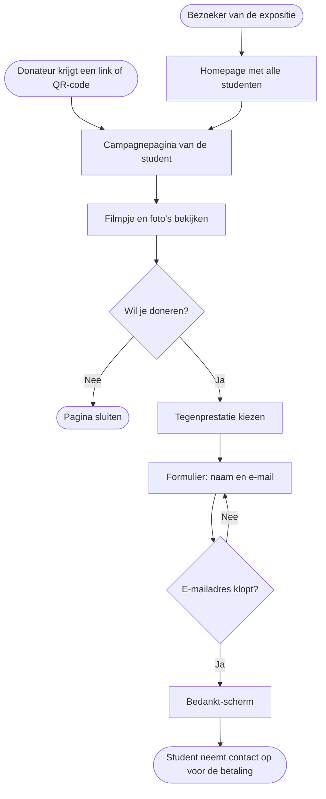
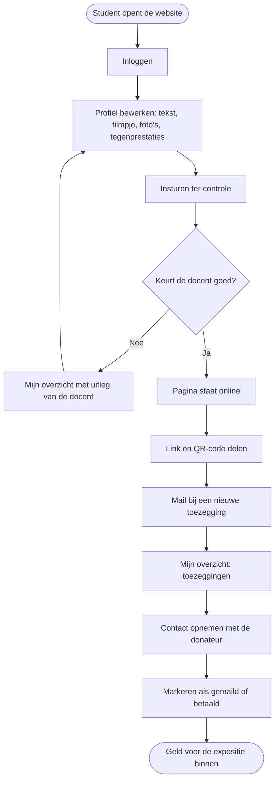
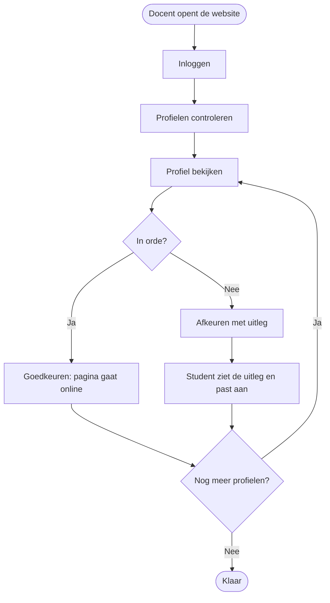
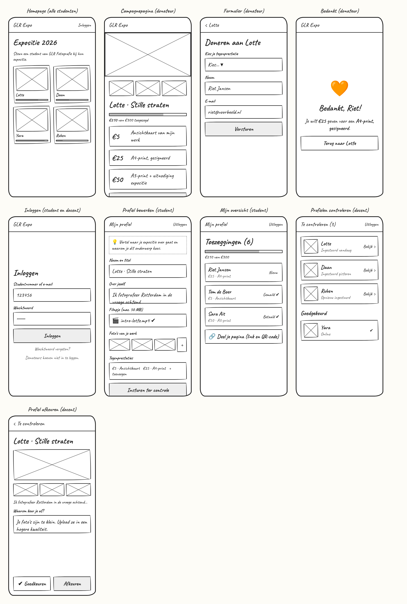
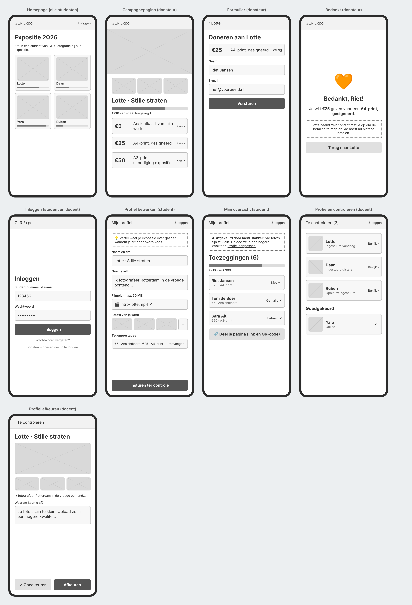
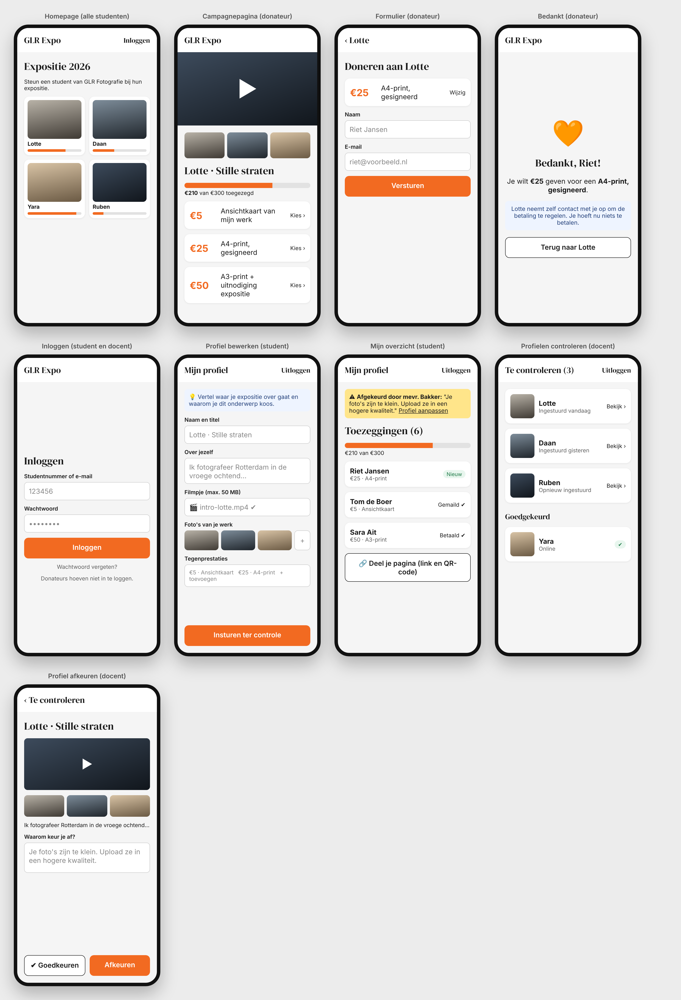

# Projectplan: GLR Crowdfunding

| | |
|---|---|
| Project | GLR Crowdfunding (2025#202) |
| Opdrachtgever | GLR Fotografie |
| Team | Groep 4 |

> **Let op:** dit is een voorbeeldplan. De namen en het onderzoek zijn verzonnen om te laten zien hoe een goed plan eruitziet.

In dit plan geven we elk inzicht, elke eis en elke test een code (zoals **I1**, **E1**, **T1**). Zo kun je zien waar iets vandaan komt.

---

## Debriefing: wat is de opdracht?

### Achtergrond

Bij de opleiding Fotografie van het Grafisch Lyceum Rotterdam (GLR) laten studenten hun beste werk zien op een expositie. Een goede expositie kost geld. Daarom zoeken studenten donateurs: mensen die geld geven. Wie geeft, krijgt daar iets voor terug. Hoe meer je geeft, hoe meer je terugkrijgt. Er bestaat al een website hiervoor (https://glrfotografieexpo.sd-lab.nl/), maar die werkt niet goed.

### De vraag van de opdrachtgever

Maak een website waarop fotografiestudenten zichzelf en hun werk laten zien, zodat mensen willen doneren. De opdrachtgever is GLR Fotografie (contactpersonen: Martin Bruining en Soraya Goldewijk).

### Doelgroep

- Studenten van GLR Fotografie, die zichzelf willen presenteren.
- Donateurs, die willen bijdragen aan de expositie van een student.
- Docenten, die de profielen controleren.

### Eisen van de opdrachtgever

- Een student maakt een profiel met: naam, beschrijving over zichzelf, een filmpje, foto's van eigen werk en tegenprestaties. Een tegenprestatie is wat de donateur terugkrijgt, bijvoorbeeld een ansichtkaart bij een donatie van €5.
- Een docent kan een profiel afkeuren. De student kan het profiel daarna aanpassen.
- Een donateur vult op de website een formulier in met naam, e-mailadres en het bedrag met de tegenprestatie.
- De student krijgt een mail of ziet in een overzicht wie wil doneren.
- De betaling gaat niet via de website. De student neemt zelf contact op met de donateur om de betaling te regelen.
- Let op veiligheid en maak een inlogsysteem met rechten per soort gebruiker.

---

## 1. Inzicht in de gebruiker

### Wat hebben we onderzocht?

Deze website heeft drie soorten gebruikers:
1. **Studenten Fotografie:** zij zoeken geld voor hun expositie.
2. **Donateurs:** familie, vrienden en andere mensen die willen helpen.
3. **Docenten:** zij controleren de profielen van studenten.

Er bestaat al een website, maar die werkt volgens de opdrachtgever niet goed. We wilden weten waarom, en wat elke gebruiker nodig heeft.

- **Interviews:** 4 studenten Fotografie, 4 mogelijke donateurs (2 ouders, 1 oma, 1 buurman) en 1 docent.
- **Enquête:** 30 mensen die ooit iets hebben gedoneerd, bijvoorbeeld via een inzamelingsactie.
- **Bestaande websites:** we hebben de huidige GLR-website bekeken en 3 bekende crowdfundingsites vergeleken.

### Wat hebben we ontdekt?

| Code | Inzicht | Bewijs |
|---|---|---|
| I1 | Donateurs willen eerst het werk van de student zien, dan pas geven. | 4 van de 4 donateurs. 22 van de 30 in de enquête. |
| I2 | Donateurs willen meteen zien wat ze krijgen voor welk bedrag. | 3 van de 4 donateurs. |
| I3 | Donateurs komen meestal via een link van de student (WhatsApp, Instagram). Ze zoeken niet zelf op de site. | 4 van de 4 studenten. 25 van de 30 in de enquête. |
| I4 | Studenten vinden het lastig om een profiel goed in te vullen. Ze weten niet wat ze moeten schrijven. | 3 van de 4 studenten. |
| I5 | Studenten raken het overzicht kwijt over wie wil doneren. | 4 van de 4 studenten. |
| I6 | De docent wil een profiel kunnen terugsturen met uitleg, zodat de student het kan verbeteren. | Interview met de docent. |

### Voor wie ontwerpen we?

**Persona 1: Lotte (18), student Fotografie**
Lotte heeft €300 nodig voor prints en lijsten voor haar expositie. Ze deelt haar pagina in de familie-app.
*"Ik weet nooit wie al iets heeft toegezegd en wie ik nog moet mailen."*
Ze heeft last van: geen overzicht (I5) en niet weten wat ze moet schrijven (I4).

**Persona 2: Oma Riet (68), donateur**
Oma Riet krijgt een link van haar kleindochter. Ze wil helpen, maar wil eerst zien wat Lotte maakt.
*"Laat me eerst de foto's zien. En wat krijg ik voor tien euro?"*
Ze heeft last van: onduidelijke pagina's (I1, I2).

**Persona 3: Mevrouw Bakker, docent Fotografie**
Ze controleert alle profielen voordat ze online komen.
*"Als er iets niet klopt, wil ik zeggen wát er niet klopt."*
Ze heeft last van: geen manier om uitleg te geven (I6).

---

## 2. Probleem en kaders

### Probleemstelling

Donateurs haken af omdat ze niet snel het werk van de student en de tegenprestaties zien (I1, I2). Studenten raken het overzicht kwijt over wie wil doneren (I5).

### Wat bouwen we wel en niet?

**Wel:** een profielpagina per student (naam, beschrijving, filmpje, foto's, tegenprestaties), een donatieformulier, een overzicht voor de student van alle toezeggingen, een mail naar de student bij een nieuwe toezegging, een docent-scherm om profielen af te keuren met uitleg, inloggen met rechten per gebruiker.

**Niet:** echt betalen via de website (de student regelt dat zelf, zoals de briefing zegt), een app, een overzicht van alle exposities, statistieken.

### Eisen met prioriteit

We gebruiken MoSCoW: **M**ust (moet), **S**hould (zou moeten), **C**ould (mag), **W**on't (dit keer niet).

| Code | Eis | Prioriteit | Komt uit |
|---|---|---|---|
| E1 | Bovenaan een profiel staan meteen de foto's en het filmpje van de student. | Must | I1, briefing |
| E2 | De tegenprestaties staan als kaartjes met bedrag en wat je krijgt. | Must | I2, briefing |
| E3 | Doneren gaat via een kort formulier: naam, e-mail, bedrag met tegenprestatie. | Must | Briefing |
| E4 | Een docent kan een profiel afkeuren met uitleg. De student kan het dan aanpassen. | Must | I6, briefing |
| E5 | Inloggen met rechten per gebruiker: student, docent. Donateurs hoeven niet in te loggen. | Must | Briefing, I3 |
| E6 | De student ziet een overzicht van alle toezeggingen en krijgt een mail bij een nieuwe. | Should | I5, briefing |
| E7 | Elk profiel heeft een eigen korte link en QR-code om te delen. | Should | I3 |
| E8 | Bij het invullen van het profiel staan tips ("Vertel waar je expositie over gaat"). | Could | I4 |
| E9 | Online betalen. | Won't | briefing: student regelt dit zelf |

---

## 3. Ideevorming en keuze

### Brainstorm

We hebben de methode "Hoe kunnen wij...?" gebruikt. Bijvoorbeeld: "Hoe kunnen wij oma Riet in 1 minuut overtuigen?" Daar kwamen 16 ideeën uit. We hebben er drie concepten van gemaakt.

### De drie concepten

**Concept A: De expositiewand**
De homepage is een grote wand met werk van alle studenten. Je klikt op een foto en komt bij het profiel van de student.

**Concept B: Persoonlijke campagnepagina**
Elke student heeft een eigen pagina die de student deelt. Bovenaan het werk, dan het verhaal, dan de tegenprestaties als kaartjes. Een balk laat zien hoeveel geld al is toegezegd.

**Concept C: Webshop**
De tegenprestaties staan in een winkel. Je "koopt" een ansichtkaart of print en steunt zo de student.

### Vergelijking met de eisen

| Eis | A: Expositiewand | B: Campagnepagina | C: Webshop |
|---|---|---|---|
| E1 werk meteen zichtbaar (Must) | ✔ op de homepage | ✔ bovenaan het profiel | ✘ alleen producten |
| E2 tegenprestaties duidelijk (Must) | ✘ pas na doorklikken | ✔ kaartjes | ✔ |
| E3 kort formulier (Must) | ✔ | ✔ | ✘ voelt als kopen, briefing wil geen betaling |
| I3 donateurs komen via een link | ✘ de wand is voor wie zelf zoekt | ✔ gemaakt om te delen | ~ |
| E6 overzicht voor student (Should) | ✔ | ✔ met voortgangsbalk | ✔ |

### Onze keuze

We kiezen **concept B, de persoonlijke campagnepagina**. Het haalt alle Must-eisen. Het past ook bij hoe donateurs echt binnenkomen: via een link van de student (I3). Oma Riet ziet meteen het werk en wat ze krijgt (I1, I2).

Concept A is mooi, maar donateurs zoeken niet zelf op de site (I3). Concept C laat het lijken alsof je iets koopt en betaalt op de site. Dat wil de opdrachtgever niet (E9).

Uit concept A nemen we één ding mee: een simpele homepage met alle studenten, voor bezoekers van de expositie zelf.

### User flows van concept B

In de diagrammen is een rechthoek een scherm of een actie, een ruit een keuze, en een afgeronde vorm het begin of einde.

#### Flow 1: donateur (doneren)

#### Flow 2: student (profiel maken en donaties volgen)

#### Flow 3: docent (profielen controleren)

---

## 4. Ontwerp en uitwerking

### Stap 1: Schetsen op papier (lo-fi)

We hebben alle 9 schermen uit de user flow op papier geschetst: homepage, campagnepagina, formulier, bedankt, inloggen, profiel bewerken, overzicht van toezeggingen, profielen controleren en profiel afkeuren. We schetsten op telefoonformaat, omdat donateurs de link vooral op hun telefoon openen (I3).

### Stap 2: Wireframes (mid-fi)

In Figma hebben we alle schermen uit de schets uitgewerkt in grijs. Ten opzichte van de schetsen hebben we dit verbeterd:

- Je klikt direct op een tegenprestatie-kaartje om te doneren. Dan hoef je in het formulier niet nog een keer te kiezen (eis E3).
- Bij "Bedankt" staat dat de student zelf contact opneemt. Zo denkt de donateur niet dat er nog online betaald moet worden (eis E9).
- Als de docent een profiel afkeurt, staat de uitleg in een gele balk bovenaan het profiel van de student (eis E4).

### Stap 3: Eindontwerp (hi-fi)

| Onderdeel | Keuze | Waarom |
|---|---|---|
| Kleuren | Wit en lichtgrijs `#F5F5F5`, tekst zwart `#1A1A1A`, knoppen GLR-oranje `#F26A21` | Het werk van de student moet opvallen, niet de website (E1). |
| Letters | Kopjes in DM Serif Display, tekst in Inter | Voelt als een expositie, maar blijft goed leesbaar voor oudere donateurs. |
| Tegenprestaties | Grote kaartjes met het bedrag groot links | Je ziet in één blik wat je krijgt (E2, I2). |
| Voortgangsbalk | Oranje balk met "€210 van €300" | Laat zien dat elke donatie helpt. |
| Knoppen | Minstens 48 pixels hoog | Makkelijk te raken op een telefoon, ook voor oudere donateurs. |

---

## 5. Techniekkeuze

### Wat hebben we overwogen?

| Optie | Voordelen | Nadelen |
|---|---|---|
| **PHP en MySQL (eigen code)** | Wij leren het op school. Draait op de schoolserver. Wij bepalen zelf de rechten. | Meer werk dan een kant-en-klaar systeem. |
| WordPress met een crowdfunding-plugin | Snel klaar. | De plugin wil online betalen, dat willen we niet (E9). Afkeuren met uitleg zit er niet in (E4). |
| Kant-en-klaar platform (zoals een bekende crowdfundingsite) | Niets zelf bouwen. | Kost geld per donatie. De docent kan profielen niet controleren. |

### Onze keuze

We bouwen de website met **PHP en een MySQL-database**, op de webserver van de school. Mails sturen we met PHPMailer.

Waarom? De opdracht vraagt om dingen die kant-en-klare systemen niet hebben: een docent die profielen afkeurt met uitleg (E4) en donaties zonder online betalen (E9). Met eigen code kunnen we dat precies zo maken. Ook de rechten per gebruiker (E5) bepalen we zelf.

Filmpjes: studenten uploaden een filmpje van maximaal 50 MB (briefing: "een filmpje kunnen uploaden"). We hebben ook overwogen om alleen een YouTube-link te gebruiken. Dat is lichter voor de server, maar niet elke student heeft YouTube. Daarom kiezen we voor uploaden, met een limiet.

Zo maken we het veilig:
- Wachtwoorden slaan we versleuteld op (`password_hash`).
- Alleen de student zelf en docenten kunnen het overzicht met toezeggingen zien.
- Het formulier controleert of een e-mailadres klopt en blokkeert spam.

---

## 6. Testen

### Zo gaan we testen

- **Wanneer:** in twee rondes. Eerst met de wireframes in Figma, daarna met de werkende versie. Na elke ronde passen we het ontwerp aan.
- **Wie:** 6 testpersonen per ronde: 3 donateurs (waarvan 1 ouder dan 60), 2 studenten Fotografie en 1 docent. Geen groepsleden.
- **Hoe:** donateurs krijgen een link via WhatsApp en doen de taak op hun eigen telefoon. Studenten en de docent werken op een laptop. Wij kijken mee, zeggen niets en schrijven op wat er gebeurt.

| Code | Taak (scenario) | Wie | Test welke eis | Uitkomst: geslaagd als |
|---|---|---|---|---|
| T1 | "Je krijgt deze link van Lotte. Doneer €25 voor een print." | Donateur | E1, E2, E3 | Binnen 2 minuten. Weet dat Lotte contact opneemt. |
| T2 | "Vul je profiel in en stuur het in." | Student | E8, E5 | Binnen 10 minuten, zonder hulp |
| T3 | "Hoeveel mensen willen al doneren? Wie moet je nog mailen?" | Student | E6 | Binnen 30 seconden |
| T4 | "Keur dit profiel af. De foto's zijn te klein." | Docent | E4 | Binnen 1 minuut. De student ziet de uitleg. |
