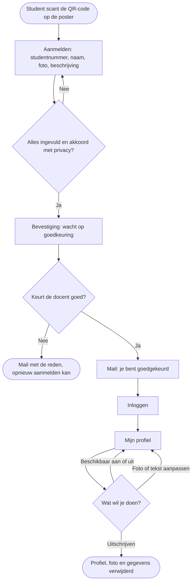
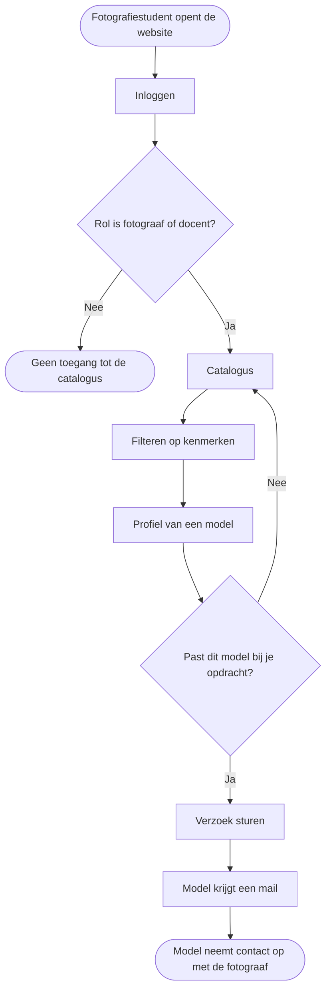
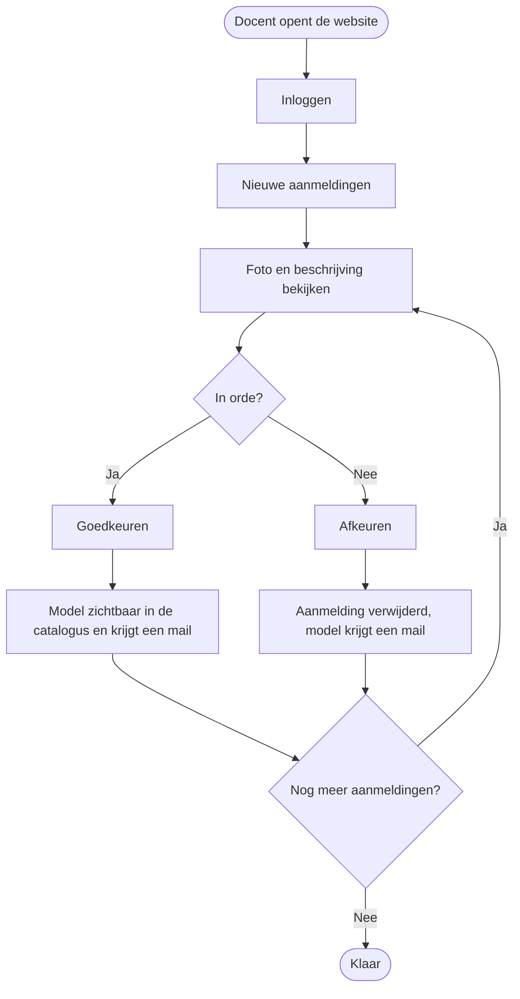
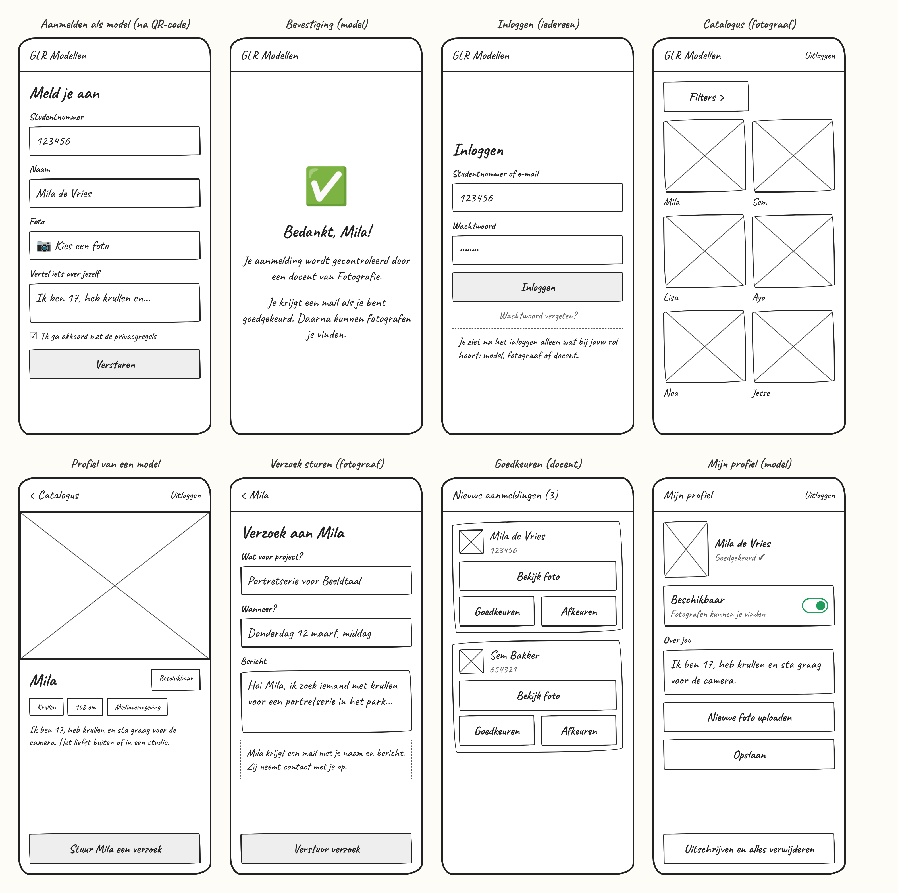
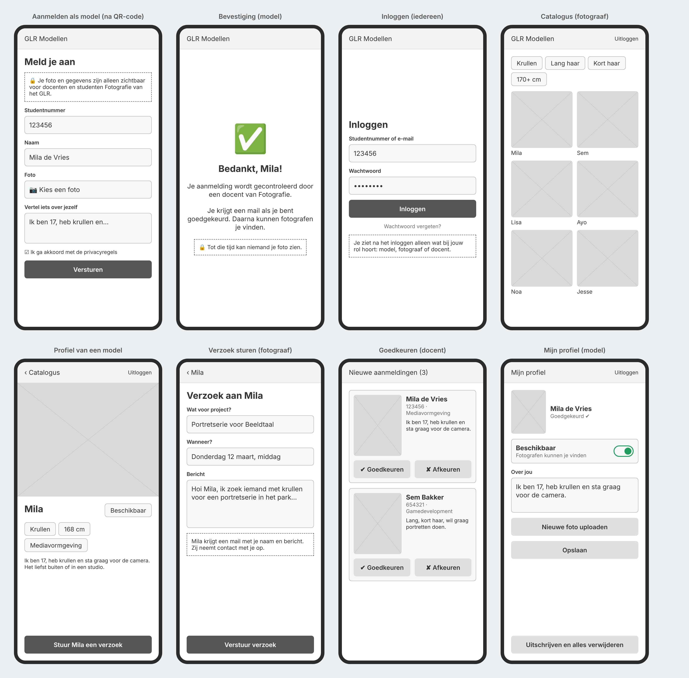
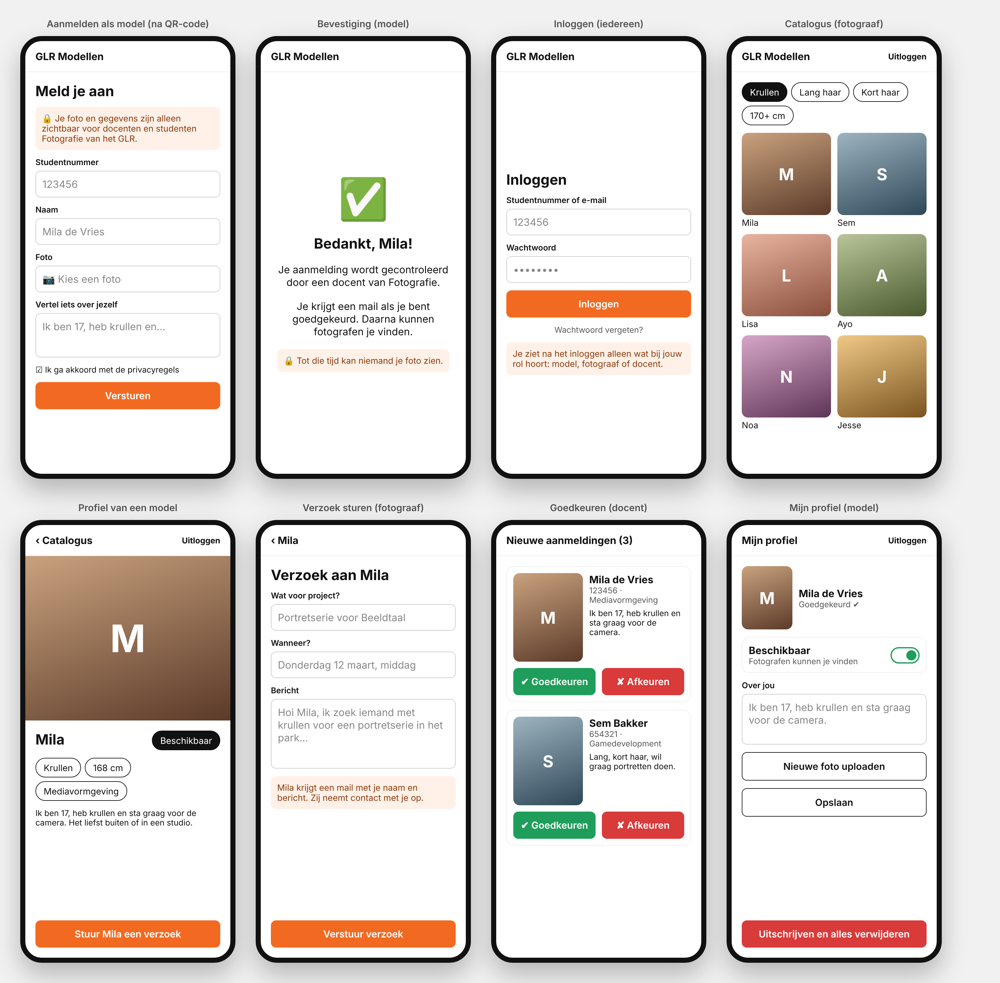

# Projectplan: GLR Modellenbureau

| | |
|---|---|
| Project | GLR modellen agency extravaganza (2025#201) |
| Opdrachtgever | GLR Fotografie |
| Team | Groep 2 |

In dit plan geven we elk inzicht, elke eis en elke test een code (zoals **I1**, **E1**, **T1**). Zo kun je zien waar iets vandaan komt.

---

## Debriefing: wat is de opdracht?

### Achtergrond

Bij de opleiding Fotografie van het Grafisch Lyceum Rotterdam (GLR) werken studenten aan projecten. Voor sommige projecten hebben ze een model nodig. Het zou handig zijn als er een plek is waar ze modellen kunnen vinden.

### De vraag van de opdrachtgever

Maak een website waarop GLR-studenten zich kunnen inschrijven als model. Fotografiestudenten kunnen op die website een model kiezen en vragen voor hun project. De opdrachtgever is GLR Fotografie (contactpersoon: Roelant Veraart).

### Doelgroep

- GLR-studenten die model willen staan.
- Studenten van de opleiding Fotografie die een model zoeken.
- Docenten Fotografie, die aanmeldingen goedkeuren.

### Eisen van de opdrachtgever

- Een student die model wil worden, scant een QR-code op een poster.
- Bij het aanmelden vult de student in: studentnummer, naam, foto en een korte beschrijving ("vertel iets over jezelf").
- Een docent van Fotografie moet de aanmelding eerst goedkeuren. Pas daarna is de student echt ingeschreven.
- Fotografiestudenten loggen in op de modellenpagina. Via de foto's komen ze bij het profiel van een model.
- De foto's en gegevens zijn privacygevoelig. Let dus goed op veiligheid.
- Bedenk een goed inlogsysteem waarin elke gebruiker de juiste rechten heeft.

---

## 1. Inzicht in de gebruiker

### Wat hebben we onderzocht?

Deze website heeft drie soorten gebruikers:
1. **Modellen:** GLR-studenten die model willen staan.
2. **Fotografen:** studenten van de opleiding Fotografie.
3. **Docenten:** docenten Fotografie die aanmeldingen goedkeuren.

We wilden weten hoe het nu gaat en waar elke groep last van heeft.

- **Interviews:** 4 fotografiestudenten, 3 studenten die model willen staan en 1 docent Fotografie.
- **Enquête:** 26 GLR-studenten van andere opleidingen. Vraag: "Zou je model willen staan? Waarom wel of niet?"
- **Observatie:** we hebben gekeken hoe twee fotografiestudenten een model zochten voor een opdracht.

### Wat hebben we ontdekt?

| Code | Inzicht | Bewijs |
|---|---|---|
| I1 | Fotografen zoeken nu modellen via Instagram en vrienden. Dat kost veel tijd, en vaak lukt het pas op het laatste moment. | 4 van de 4 fotografen. Observatie: zoeken duurde 2 dagen. |
| I2 | Fotografen zoeken een model dat bij hun opdracht past (bijvoorbeeld lengte, haar, stijl). | 4 van de 4 fotografen. |
| I3 | Studenten willen alleen model staan als hun foto niet voor iedereen online staat. | 19 van de 26 in de enquête. |
| I4 | Modellen willen zelf kunnen zeggen of ze beschikbaar zijn, en zich ook weer kunnen uitschrijven. | 3 van de 3 modellen. |
| I5 | De docent heeft weinig tijd. Goedkeuren moet in een paar klikken. | Interview met de docent. |
| I6 | Studenten scannen een QR-code meestal snel op de gang, met hun telefoon. | Observatie bij posters in de school. |

### Voor wie ontwerpen we?

**Persona 1: Mila (17), wil model staan**
Mila zit op Mediavormgeving. Ze vindt het leuk om op de foto te gaan, maar ze wil niet dat vreemden haar foto zien.
*"Als alleen studenten van Fotografie mij kunnen zien, doe ik mee."*
Ze heeft last van: zorgen over privacy (I3) en niet weten of ze kan stoppen (I4).

**Persona 2: Joris (18), fotografiestudent**
Joris moet over een week een portretserie inleveren. Hij zoekt iemand met krullen.
*"Ik stuur nu tien mensen op Instagram en de helft reageert niet."*
Hij heeft last van: zoeken kost te veel tijd (I1) en hij kan niet zoeken op uiterlijk (I2).

**Persona 3: Meneer De Wit, docent Fotografie**
Hij moet elke aanmelding controleren, maar heeft het druk.
*"Laat me gewoon een lijstje zien met goedkeuren of afwijzen."*
Hij heeft last van: weinig tijd (I5).

---

## 2. Probleem en kaders

### Probleemstelling

Fotografiestudenten verliezen veel tijd met het zoeken naar een passend model (I1, I2). Andere GLR-studenten willen wel model staan, maar alleen als hun foto en gegevens veilig zijn (I3).

### Wat bouwen we wel en niet?

**Wel:** aanmelden als model via een QR-code, goedkeuren door een docent, inloggen met de juiste rechten per gebruiker, een overzicht van modellen met foto's, een profielpagina per model, een knop om een model een verzoek te sturen.

**Niet:** een chat in de website, een agenda om shoots te plannen, inloggen met het schoolaccount van het GLR, een app.

### Eisen met prioriteit

We gebruiken MoSCoW: **M**ust (moet), **S**hould (zou moeten), **C**ould (mag), **W**on't (dit keer niet).

| Code | Eis | Prioriteit | Komt uit |
|---|---|---|---|
| E1 | Alleen ingelogde fotografiestudenten en docenten kunnen modellen zien. | Must | I3, briefing |
| E2 | Een model is pas zichtbaar als een docent het heeft goedgekeurd. | Must | Briefing |
| E3 | Aanmelden via QR-code met studentnummer, naam, foto en beschrijving. Werkt op een telefoon. | Must | I6, briefing |
| E4 | Elke gebruiker heeft eigen rechten: model, fotograaf of docent. | Must | Briefing |
| E5 | De docent kan een aanmelding goed- of afkeuren met één klik. | Should | I5 |
| E6 | Fotografen kunnen filteren op kenmerken (bijvoorbeeld haarkleur, lengte). | Should | I2 |
| E7 | Een model kan zich op "niet beschikbaar" zetten of zich uitschrijven. | Should | I4 |
| E8 | Een fotograaf kan via de website een verzoek sturen naar een model. | Could | I1 |
| E9 | Inloggen met het schoolaccount. | Won't | te groot voor dit project |

---

## 3. Ideevorming en keuze

### Brainstorm

We hebben een mindmap gemaakt rond de vraag: "Hoe vindt een fotograaf snel het juiste model?" Daar kwamen 11 ideeën uit. We hebben er drie concepten van gemaakt.

### De drie concepten

**Concept A: Modellen-catalogus**
Een overzicht met foto's van alle modellen. De fotograaf kan filteren en klikt op een foto om het profiel te zien. Via een knop stuurt de fotograaf een verzoek.

**Concept B: Oproepen-bord**
De fotograaf plaatst een oproep ("Ik zoek iemand met krullen voor donderdag"). Modellen reageren op de oproep.

**Concept C: Matchen**
Net als een datingapp: de fotograaf swipet door modellen. Als beide "ja" zeggen, is er een match.

### Vergelijking met de eisen

| Eis | A: Catalogus | B: Oproepen-bord | C: Matchen |
|---|---|---|---|
| E1 alleen voor ingelogde fotografen (Must) | ✔ | ✘ modellen moeten oproepen ook zien | ✔ |
| E2 goedkeuren door docent (Must) | ✔ | ✔ | ✔ |
| E3 aanmelden via QR (Must) | ✔ | ✔ | ✔ |
| E4 rechten per gebruiker (Must) | ✔ eenvoudig | ✔ | ✘ ingewikkeld, modellen moeten ook swipen |
| Briefing: "fotografen kiezen hun model" | ✔ | ✘ modellen kiezen | ~ allebei |
| E6 filteren (Should) | ✔ | ✘ | ✘ |

### Onze keuze

We kiezen **concept A, de modellen-catalogus**. Het haalt alle Must-eisen en past bij de briefing: de fotograaf kiest het model. Het is ook het veiligst: modellen hoeven zelf niets te zien van andere studenten (I3).

Concept B laat modellen oproepen zien. Dan moeten modellen ook kunnen inloggen en worden de rechten ingewikkelder. Concept C voelt te veel als een datingapp. Twee modellen in onze interviews vonden dat ongemakkelijk.

### User flows van concept A

In de diagrammen is een rechthoek een scherm of een actie, een ruit een keuze, en een afgeronde vorm het begin of einde.

#### Flow 1: model (aanmelden en beheren)

#### Flow 2: fotograaf (model zoeken)

#### Flow 3: docent (aanmeldingen controleren)

---

## 4. Ontwerp en uitwerking

### Stap 1: Schetsen op papier (lo-fi)

We hebben alle 8 schermen uit de user flow op papier geschetst: aanmelden, bevestiging, inloggen, catalogus, profiel van een model, verzoek sturen, goedkeuren door de docent en het eigen profiel van het model.

### Stap 2: Wireframes (mid-fi)

In Figma hebben we alle schermen uit de schets uitgewerkt in grijs. Ten opzichte van de schetsen hebben we dit verbeterd:

- Bij het aanmelden staat wie je foto kan zien: "Alleen docenten en studenten Fotografie." (eis E1, I3)
- De docent ziet de foto groot naast de knoppen, zodat hij niet hoeft door te klikken (eis E5).
- De filters staan altijd open, niet achter een knop (eis E6).

### Stap 3: Eindontwerp (hi-fi)

| Onderdeel | Keuze | Waarom |
|---|---|---|
| Kleuren | Wit, zwart `#111111`, en GLR-oranje `#F26A21` voor knoppen | Rustig, zodat de foto's van de modellen opvallen. Oranje past bij de school. |
| Letters | Inter voor alles | Goed leesbaar, ook op een telefoon (E3). |
| Catalogus | Grote foto's in een raster, 4 naast elkaar op laptop, 2 op telefoon | Fotografen kiezen op beeld (I2). |
| Privacy-melding | Slotje met de tekst "Alleen zichtbaar voor GLR Fotografie" | Laat zien dat de foto veilig is (I3). |
| Docent-scherm | Lijst met groene en rode knop per aanmelding | Snel goedkeuren (E5, I5). |

---

## 5. Techniekkeuze

### Wat hebben we overwogen?

| Optie | Voordelen | Nadelen |
|---|---|---|
| **PHP en MySQL (eigen code)** | Wij leren het op school. Draait op de schoolserver. We bepalen zelf precies wie wat mag zien. | Meer werk dan een kant-en-klaar systeem. |
| WordPress met plugins | Snel een website. | Moeilijk om rechten precies goed in te stellen. Plugins kunnen onveilig zijn. |
| Firebase (van Google) | Inloggen zit er al in. | Gegevens staan bij Google, buiten de school. Dat is lastig voor privacy (AVG). |

### Onze keuze

We bouwen de website met **PHP en een MySQL-database**, op de webserver van de school.

Waarom? De briefing zegt dat foto's en gegevens privacygevoelig zijn. Onze enquête liet zien dat studenten alleen meedoen als hun foto veilig is (I3). Met eigen code bepalen we zelf wie wat mag zien (E1, E4). De gegevens blijven op de server van de school. Firebase hebben we daarom niet gekozen. WordPress ook niet, omdat het lastig is om drie soorten gebruikers precies de juiste rechten te geven.

Zo maken we het veilig:
- Wachtwoorden slaan we versleuteld op (`password_hash`).
- Foto's staan in een map die je niet direct via een link kunt openen. Alleen ingelogde fotografen en docenten krijgen ze te zien.
- Bij elke pagina checken we of de gebruiker de juiste rol heeft.
- Een model kan zichzelf verwijderen. Dan verdwijnen ook de foto en gegevens.

---

## 6. Testen

### Zo gaan we testen

- **Wanneer:** in twee rondes. Eerst met de wireframes in Figma, daarna met de werkende versie. Na elke ronde passen we het ontwerp aan.
- **Prototype:** het klikbare Figma-prototype voor ronde 1 staat klaar: [open het Figma-bestand](https://www.figma.com/design/M693Jxfk1pl4hLXB6hPwkX). Zo gebruik je het:
  1. Kies in Figma **Duplicate** (of **Duplicate to your drafts**). Nu heb je je eigen kopie.
  2. Klik rechtsboven op **Present (▶)** en kies linksboven de flow die je wilt testen:
     - **Model: aanmelden** begint bij het scherm "Aanmelden als model (na QR-code)".
     - **Fotograaf: model zoeken** begint bij het scherm "Inloggen (iedereen)".
     - **Docent: aanmeldingen controleren** begint bij het scherm "Goedkeuren (docent)".
     - **Model: profiel beheren** begint bij het scherm "Mijn profiel (model)".
  3. Wil je op een telefoon testen? Klik op **Share prototype** en open de link op de telefoon.
  4. Typen in invulvelden werkt niet in een Figma-prototype. Vertel je testpersoon dat de velden al ingevuld zijn.
- **Wie:** 6 testpersonen per ronde: 2 modellen, 3 fotografiestudenten en 1 docent. Geen groepsleden.
- **Hoe:** ze doen de taken op hun eigen telefoon of laptop. Wij kijken mee, zeggen niets en schrijven op wat er gebeurt.

| Code | Taak (scenario) | Wie | Test welke eis | Uitkomst: geslaagd als |
|---|---|---|---|---|
| T1 | "Scan de QR-code en meld je aan als model." | Model | E3, E1 | Binnen 3 minuten. Weet wie de foto kan zien. |
| T2 | "Zoek een model met krullen en stuur een verzoek." | Fotograaf | E6, E8 | Binnen 2 minuten |
| T3 | "Keur de nieuwe aanmelding goed." | Docent | E2, E5 | Binnen 30 seconden |
| T4 | "Zet jezelf op niet beschikbaar." | Model | E7 | Zonder hulp |
| T5 | "Open de catalogus zonder in te loggen." | Iedereen | E1 | Lukt niet: je moet eerst inloggen |
