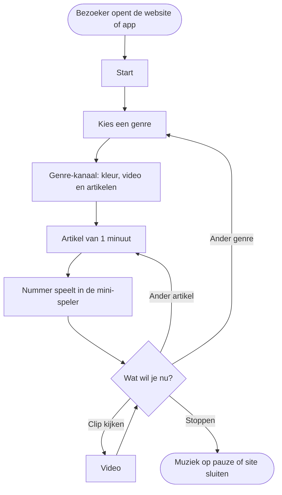
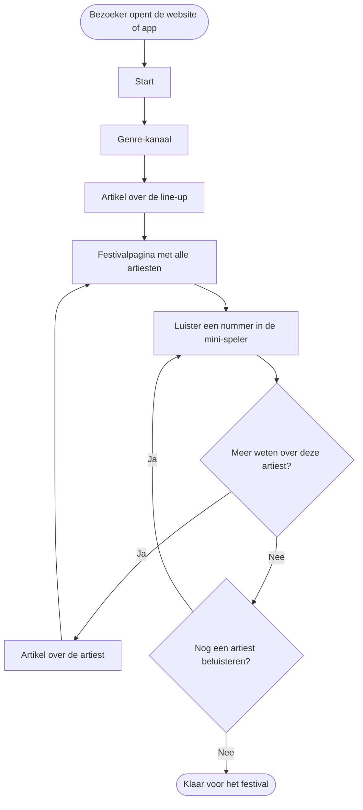
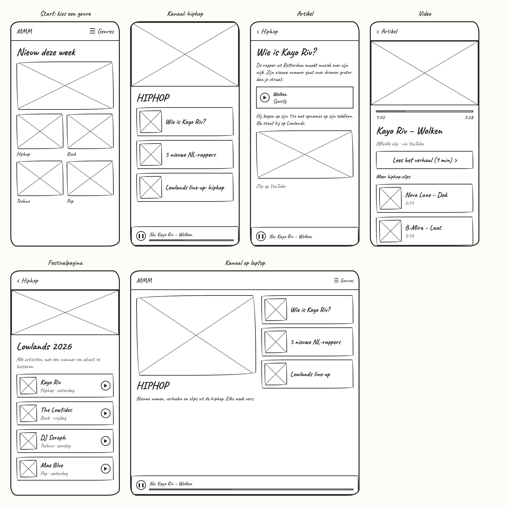
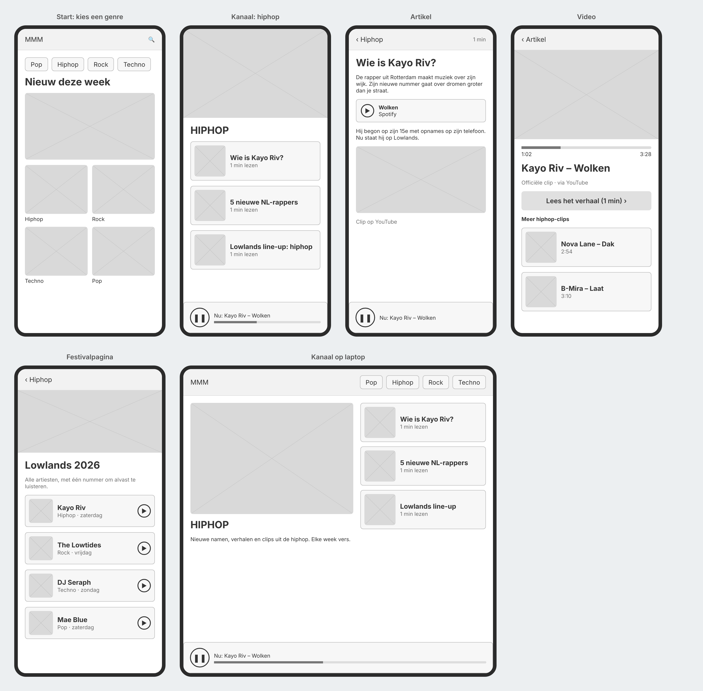
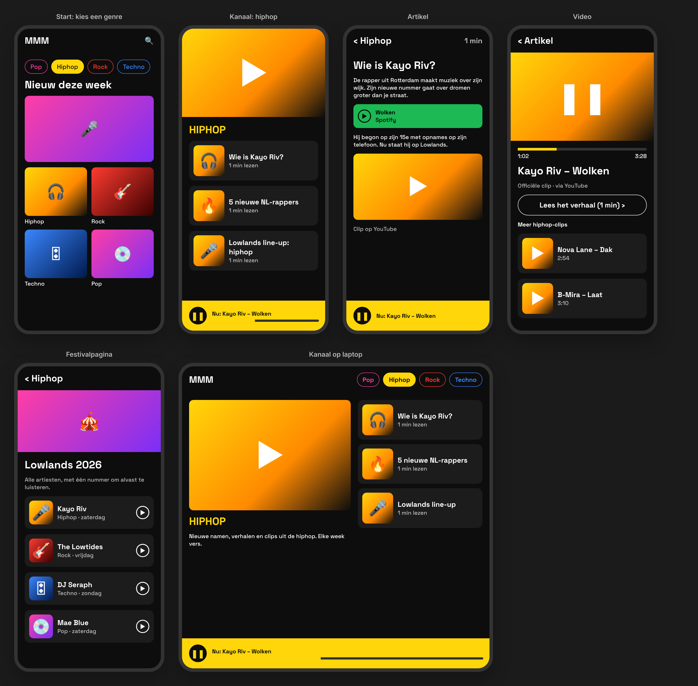

# Projectplan: Music Magnet Magazine (MMM)

| | |
|---|---|
| Project | Music Magnet Magazine website en app (2024#009) |
| Opdrachtgever | MMM |
| Team | Groep 5 |

In dit plan geven we elk inzicht, elke eis en elke test een code (zoals **I1**, **E1**, **T1**). Zo kun je zien waar iets vandaan komt.

---

## Debriefing: wat is de opdracht?

### Achtergrond

Vroeger had MTV een muziekmagazine dat je online en op papier kon lezen. Nu luisteren veel mensen naar podcasts en veranderen digitale media snel. Veel online muziekmagazines zijn ouderwets en saai. Music Magnet Magazine (MMM) wil een nieuwe, frisse manier om muziek te beleven: lezen over muziek, luisteren naar muziek en muziekvideo's kijken, allemaal op één plek. Als je een genre of kanaal aanklikt, komen tekst, muziek en video samen ("fuseren").

### De vraag van de opdrachtgever

Ontwerp en maak een nieuwe website én een app voor smartphones voor MMM. Daarin komen drie dingen samen:
- lezen over muziek;
- luisteren naar muziek;
- muziekvideo's kijken.

### Doelgroep

- Jongeren van 14 tot 25 jaar.
- Muziekliefhebbers.
- Festivalgangers.
- Iedereen die nieuwe muziek wil ontdekken.

### Doel

Jongeren een nieuwe en complete muziekervaring geven met een moderne website en app.

### Wat lever je op?

- 5 voorbeelden van online muziekmagazines die je inspireren.
- Onderzoek naar bestaande muziekapps en wat ze kunnen.
- Een technisch ontwerp van de website en de app.
- Een visueel ontwerp van de website en de app.
- Een werkende website en app die je test op telefoon, tablet en laptop.

### Inspiratie van de opdrachtgever

- https://dmy.co/
- https://www.nme.com/music

---

## 1. Inzicht in de gebruiker

### Wat hebben we onderzocht?

De briefing noemt jongeren van 14 tot 25 jaar, muziekliefhebbers en festivalgangers. We wilden weten hoe zij nu nieuwe muziek vinden en wat ze daaraan irritant vinden.

- **Interviews:** 6 jongeren tussen 15 en 23 jaar. Twee van hen gaan elke zomer naar festivals.
- **Enquête:** 42 jongeren op school en in onze sportclubs.
- **Bestaande platforms:** we hebben 5 online muziekmagazines bekeken (waaronder DMY en NME) en 4 muziekapps (Spotify, YouTube Music, TikTok, SoundCloud).

### Wat hebben we ontdekt?

| Code | Inzicht | Bewijs |
|---|---|---|
| I1 | Jongeren gebruiken 3 of meer apps om muziek te ontdekken. Ze springen steeds heen en weer. | 35 van de 42 in de enquête. |
| I2 | Lange artikelen lezen ze bijna nooit. Een kort verhaal over een artiest vinden ze wel leuk. | 5 van de 6 interviews. |
| I3 | Als ze over een nummer lezen, willen ze het meteen horen. | 6 van de 6 interviews. |
| I4 | Ze ontdekken muziek vooral per sfeer of genre, niet per artiest. | 28 van de 42. |
| I5 | Muziekmagazines zien er "oud" en "vol met reclame" uit. | 4 van de 6 interviews en onze vergelijking. |
| I6 | Ze gebruiken het vooral op hun telefoon, maar thuis ook op de laptop. | 39 van de 42 vooral telefoon. |

### Voor wie ontwerpen we?

**Persona 1: Noor (16), scholier**
Noor luistert in de bus naar muziek. Ze vindt nieuwe nummers via TikTok, zoekt ze dan op Spotify en kijkt de clip op YouTube.
*"Ik heb drie apps nodig voor één nummer. Dat is echt irritant."*
Ze heeft last van: steeds wisselen tussen apps (I1, I3).

**Persona 2: Daan (21), festivalganger**
Daan wil weten wie er op een festival staat. Hij wil de artiesten snel leren kennen voordat hij gaat.
*"Vertel me in een minuut waarom ik deze band moet zien."*
Hij heeft last van: lange artikelen (I2) en saaie magazines (I5).

---

## 2. Probleem en kaders

### Probleemstelling

Jongeren moeten tussen drie of meer apps wisselen om over muziek te lezen, het te horen en de clip te zien (I1, I3). Bestaande muziekmagazines zijn te lang en ouderwets voor hen (I2, I5).

### Wat bouwen we wel en niet?

**Wel:** een website en een app met genre-kanalen. In een kanaal komen een kort artikel, het nummer en de video samen. Een mini-speler die blijft spelen als je verder leest. Werkt op telefoon en laptop.

**Niet:** eigen muziek uploaden of opslaan (we gebruiken Spotify- en YouTube-spelers), accounts en reacties, podcasts maken, een systeem waarmee de redactie artikelen schrijft.

### Eisen met prioriteit

We gebruiken MoSCoW: **M**ust (moet), **S**hould (zou moeten), **C**ould (mag), **W**on't (dit keer niet).

| Code | Eis | Prioriteit | Komt uit |
|---|---|---|---|
| E1 | Lezen, luisteren en kijken op één scherm, zonder naar een andere app te gaan. | Must | I1, I3, briefing |
| E2 | Als je een genre aanklikt, komen tekst, muziek en video samen ("fuseren"). | Must | I4, briefing |
| E3 | Een artikel is kort: maximaal 1 minuut lezen. | Must | I2 |
| E4 | Werkt goed op telefoon én laptop. | Must | I6, briefing |
| E5 | De muziek blijft spelen als je naar een ander artikel gaat. | Should | I3 |
| E6 | Frisse, jonge uitstraling, zonder reclame. | Should | I5 |
| E7 | Festivalpagina met alle artiesten van één festival. | Could | Persona Daan |
| E8 | Accounts, likes en reacties. | Won't | buiten scope |

---

## 3. Ideevorming en keuze

### Brainstorm

Iedereen in het team heeft 6 snelle schetsen gemaakt in 8 minuten. Van de 24 schetsen hebben we de beste ideeën samengevoegd tot drie concepten.

### De drie concepten

**Concept A: Genre-kanalen**
Je kiest een genre, bijvoorbeeld hiphop. Het scherm verandert dan helemaal: andere kleuren, een video op de achtergrond, korte artikelen en een speler onderin. Alles van dat genre komt samen.

**Concept B: Swipe-feed**
Net als TikTok. Je swipet omhoog en krijgt steeds een nieuw nummer met video en een korte tekst.

**Concept C: Online magazine**
Een gewoon magazine met artikelen. In het artikel staan de nummers en clips.

### Vergelijking met de eisen

| Eis | A: Genre-kanalen | B: Swipe-feed | C: Online magazine |
|---|---|---|---|
| E1 alles op één scherm (Must) | ✔ | ✔ | ✔ |
| E2 genre laat alles samenkomen (Must) | ✔ dat is het hele idee | ✘ geen genres, alles door elkaar | ✘ alleen per artikel |
| E3 korte artikelen (Must) | ✔ | ✔ heel kort | ✘ lange artikelen |
| E4 telefoon en laptop (Must) | ✔ | ✘ werkt alleen goed op telefoon | ✔ |
| E5 muziek blijft spelen (Should) | ✔ mini-speler | ✘ stopt bij elke swipe | ✘ |

### Onze keuze

We kiezen **concept A, genre-kanalen**. Het is het enige concept dat alle Must-eisen haalt. Het past ook het best bij de briefing: daar staat dat de kanalen "fuseren" als je een genre aanklikt (E2).

Concept B was populair in ons team, maar het werkt niet goed op een laptop (E4) en heeft geen genres (E2). Concept C lijkt te veel op de oude magazines waar jongeren op afhaken (I2, I5).

### User flows van concept A

In de diagrammen is een rechthoek een scherm of een actie, een ruit een keuze, en een afgeronde vorm het begin of einde.

#### Flow 1: muziek ontdekken via een genre

#### Flow 2: een festival voorbereiden

---

## 4. Ontwerp en uitwerking

### Stap 1: Schetsen op papier (lo-fi)

We hebben alle 6 schermen uit de user flow op papier geschetst: start, genre-kanaal, artikel, video, festivalpagina en het kanaal op een laptop.

### Stap 2: Wireframes (mid-fi)

In Figma hebben we alle schermen uit de schets uitgewerkt in grijs. Ten opzichte van de schetsen hebben we dit verbeterd:

- De genreknoppen staan bovenaan in beeld, niet verstopt in een menu (eis E2).
- Bij elk artikel staat "1 min", zodat je ziet dat het kort is (eis E3).
- De mini-speler heeft een grotere pauzeknop (eis E5).

### Stap 3: Eindontwerp (hi-fi)

| Onderdeel | Keuze | Waarom |
|---|---|---|
| Kleuren | Basis zwart `#0D0D0D` en wit. Elk genre heeft een eigen felle kleur: pop roze `#FF3EA5`, hiphop geel `#FFD60A`, rock rood `#FF3B30`, techno blauw `#3A86FF`. | Als je een genre kiest, kleurt het hele scherm mee. Zo voel je het "fuseren" (E2). Fel en jong (E6). |
| Letters | Kopjes in Space Grotesk (dik), tekst in Inter | Modern en goed leesbaar op een kleine telefoon (E4). |
| Beweging | Bij het kiezen van een genre schuift de kleur over het scherm | Laat zien dat het kanaal verandert (E2). |
| Mini-speler | Altijd onderin, ook als je verder scrolt | Muziek blijft spelen (E5, I3). |

---

## 5. Techniekkeuze

### Wat hebben we overwogen?

De briefing vraagt om een website én een app.

| Optie | Voordelen | Nadelen |
|---|---|---|
| **Eén responsive web-app (HTML, CSS, JavaScript)** | Eén keer bouwen, werkt als website en als app op je beginscherm. | Kan geen muziek afspelen als het scherm uit staat. |
| Website + aparte app in Kotlin | Echte app uit de Play Store. | Alles twee keer bouwen. Werkt niet op iPhone. |
| React Native + website | Echte app voor iPhone en Android. | Nog steeds twee projecten. Wij kennen React nog niet. |

### Onze keuze

We bouwen **één responsive web-app in HTML, CSS en JavaScript**. Je kunt hem openen als website en op je telefoon op je beginscherm zetten als app. De muziek en video's komen van Spotify en YouTube. Die kun je in je eigen pagina zetten met hun speler (embed). De artikelen staan in een JSON-bestand.

Waarom? 39 van de 42 jongeren gebruiken het op de telefoon, maar ze willen het thuis ook op de laptop (I6, eis E4). Eén web-app werkt op allebei. Spotify en YouTube gebruiken we omdat jongeren daar al zijn (I1) en wij geen muziekrechten hebben. Een aparte Kotlin-app hebben we niet gekozen: dan bouwen we alles twee keer en werkt het niet op iPhones.

---

## 6. Testen

### Zo gaan we testen

- **Wanneer:** in twee rondes. Eerst met de wireframes in Figma, daarna met de werkende versie. Na elke ronde passen we het ontwerp aan.
- **Prototype:** het klikbare Figma-prototype voor ronde 1 staat klaar: [open het Figma-bestand](https://www.figma.com/design/zBHpqHIOHlG2kSoscij3tk). Zo gebruik je het:
  1. Kies in Figma **Duplicate** (of **Duplicate to your drafts**). Nu heb je je eigen kopie.
  2. Klik rechtsboven op **Present (▶)** en kies linksboven de flow die je wilt testen:
     - **Muziek ontdekken** begint bij het scherm "Start: kies een genre".
     - **Festival voorbereiden** begint bij het scherm "Kanaal: hiphop".
  3. Wil je op een telefoon testen? Klik op **Share prototype** en open de link op de telefoon.
  4. Typen in invulvelden werkt niet in een Figma-prototype. Vertel je testpersoon dat de velden al ingevuld zijn.
- **Wie:** 5 jongeren tussen 14 en 25 per ronde. Geen groepsleden. Minstens één festivalganger.
- **Hoe:** ze gebruiken het prototype op hun eigen telefoon. Eén taak doen ze op een laptop. Wij kijken mee, zeggen niets en schrijven op wat er gebeurt.

| Code | Taak (scenario) | Test welke eis | Uitkomst: geslaagd als |
|---|---|---|---|
| T1 | "Ga naar het hiphop-kanaal." | E2 | Binnen 15 seconden |
| T2 | "Lees een artikel en luister naar het nummer dat erbij hoort." | E1, E3 | Zonder de site te verlaten |
| T3 | "Ga naar een ander artikel. Zet daarna de muziek op pauze." | E5 | Muziek blijft spelen, pauze lukt |
| T4 | "Doe taak T2 nog een keer op de laptop." | E4 | Zonder hulp |
