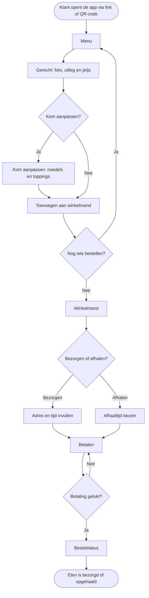
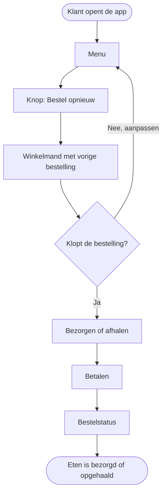
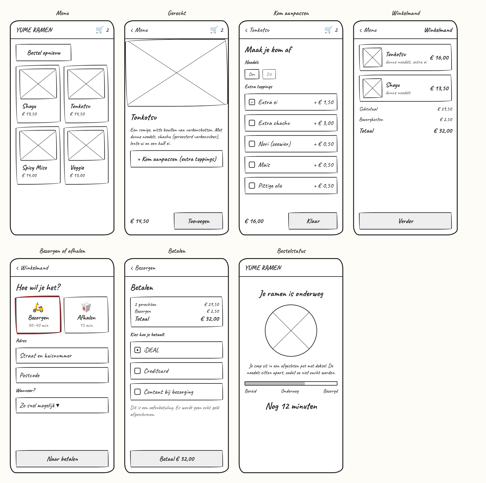
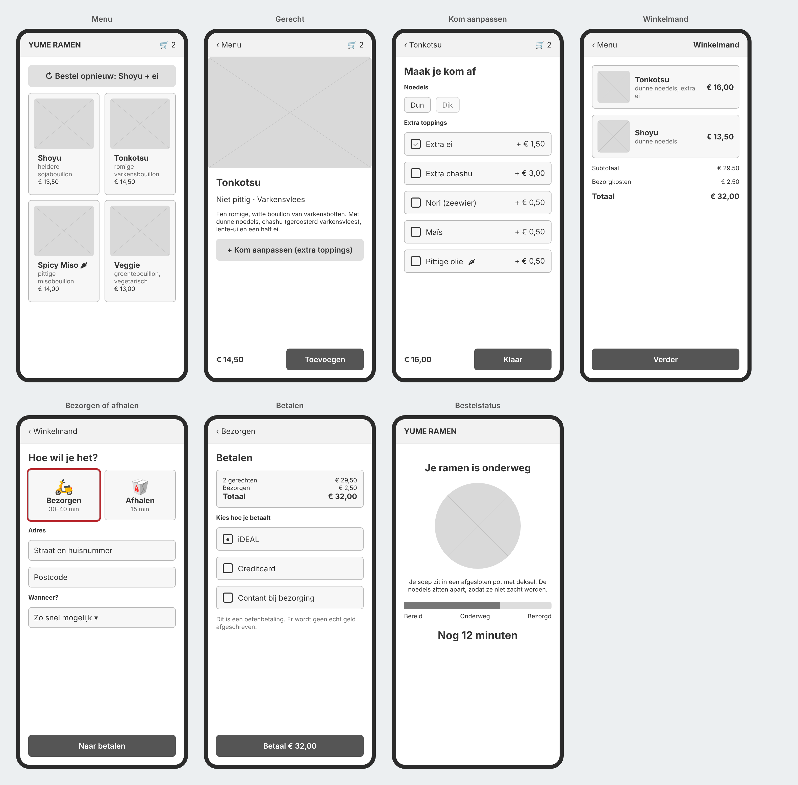
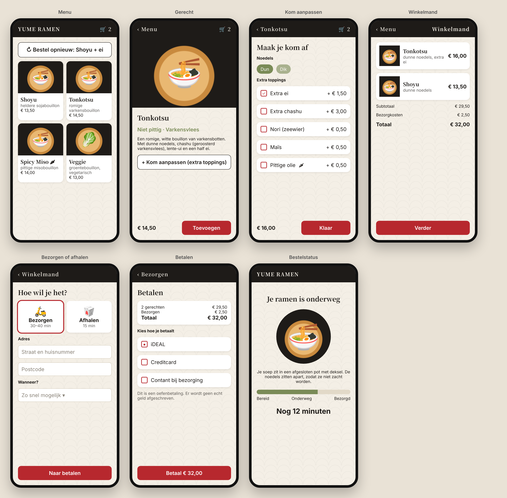

# Projectplan: Yume Ramen bezorgapp

| | |
|---|---|
| Project | Yume Ramen bezorgapp (2024#008) |
| Opdrachtgever | Yume Ramen |
| Team | Groep 3 |

In dit plan geven we elk inzicht, elke eis en elke test een code (zoals **I1**, **E1**, **T1**). Zo kun je zien waar iets vandaan komt.

---

## Debriefing: wat is de opdracht?

### Achtergrond

Er zijn steeds meer Japanse noedelrestaurants in Nederland, vooral in Amsterdam, Rotterdam en Utrecht. Ramen is een Japans gerecht met noedels in bouillon. Restaurant Yume Ramen bezorgt ramen en je kunt het ook afhalen. Yume Ramen wil een eigen bezorgapp waarin je de Japanse sfeer voelt.

### De vraag van de opdrachtgever

Ontwerp en maak een sfeervolle bezorgapp voor Yume Ramen. De app moet:
- er mooi uitzien en duidelijk laten zien dat het om Japanse cultuur gaat;
- goed en soepel werken;
- klanten snel en makkelijk een gerecht laten kiezen en thuis laten bezorgen.

### Doelgroep

- Mensen die van ramen houden.
- Mensen die graag eten laten bezorgen.
- Jong en oud: vaste ramenfans én nieuwe klanten.

### Doel

Klanten kunnen snel en makkelijk ramen bestellen voor thuis, in een app met een Japanse uitstraling.

### Wat lever je op?

- 5 voorbeelden van bestaande bezorgapps die je inspireren.
- 10 inspiratiebronnen over Japan (kleuren, symbolen, ontwerpstijl).
- Een technisch ontwerp van de app.
- Een visueel ontwerp van alle schermen.
- Minimaal 2 werkende prototypes, getest met echte gebruikers.
- Een werkende app die je test op telefoons en tablets.

### Inspiratie van de opdrachtgever

- https://www.youtube.com/watch?v=Q2blfrQBH1g
- https://www.youtube.com/watch?v=Gu6SC8vABgk

---

## 1. Inzicht in de gebruiker

### Wat hebben we onderzocht?

De briefing zegt dat de doelgroep "jong en oud" is, "ramenliefhebbers en nieuwe klanten". Dat is nog te breed. We wilden weten waar mensen echt last van hebben als ze ramen bestellen.

- **Interviews:** we hebben 6 mensen geïnterviewd (3 ramenfans en 3 mensen die nog nooit ramen hadden gegeten). Elk gesprek duurde ongeveer 15 minuten.
- **Enquête:** 31 mensen hebben onze online vragenlijst ingevuld.
- **Bestaande apps:** we hebben 5 bezorgapps bekeken en 10 Japanse inspiratiebronnen verzameld (zie map `/onderzoek`).

### Wat hebben we ontdekt?

| Code | Inzicht | Bewijs |
|---|---|---|
| I1 | Nieuwe klanten weten niet wat de gerechten zijn. Woorden als *tonkotsu* en *shoyu* zeggen ze niets. | 3 van de 3 nieuwe klanten in de interviews. 18 van de 31 in de enquête. |
| I2 | Mensen willen binnen een paar minuten klaar zijn met bestellen. | 24 van de 31 bestellen "als ik al honger heb". |
| I3 | Mensen zijn bang dat de soep koud of gemorst aankomt. | 4 van de 6 interviews. |
| I4 | Mensen willen geen extra app installeren voor één restaurant. | 20 van de 31 in de enquête. |
| I5 | Fans willen hun vaste bestelling snel opnieuw bestellen. | 3 van de 3 fans. |
| I6 | Bestaande bezorgapps zien er allemaal hetzelfde uit. Je proeft de sfeer van het restaurant niet. | Onze vergelijking van 5 apps. |

### Voor wie ontwerpen we?

**Persona 1: Sanne (19), student**
Sanne bestelt op vrijdagavond met huisgenoten. Ze heeft honger en weinig geduld. Ze kiest bijna altijd dezelfde ramen.
*"Ik wil gewoon op één knop drukken en dan komt mijn eten."*
Ze heeft last van: lang zoeken (I2) en elke keer alles opnieuw invullen (I5).

**Persona 2: Ahmed (45), nieuwe klant**
Ahmed heeft nog nooit ramen gegeten. Zijn dochter raadde het aan. Hij weet niet wat hij moet kiezen en is bang dat het te pittig is.
*"Ik wil weten wat ik eet voordat ik betaal."*
Hij heeft last van: onbekende namen (I1) en angst voor koude soep (I3).

---

## 2. Probleem en kaders

### Probleemstelling

Nieuwe klanten bestellen geen ramen omdat ze de gerechten niet kennen (I1), en vaste klanten vinden bestellen te traag (I2, I5). Yume Ramen heeft nog geen eigen app die snel werkt én de Japanse sfeer laat voelen (I6).

### Wat bouwen we wel en niet?

**Wel:** het menu, uitleg per gerecht, een kom aanpassen (extra toppings), winkelmand, bezorgen of afhalen kiezen, afrekenen (nep-betaling), de bestelstatus volgen.

**Niet:** echte betalingen, een systeem voor de keuken, klantaccounts met spaarpunten, andere talen dan Nederlands.

### Eisen met prioriteit

We gebruiken MoSCoW: **M**ust (moet), **S**hould (zou moeten), **C**ould (mag), **W**on't (dit keer niet).

| Code | Eis | Prioriteit | Komt uit |
|---|---|---|---|
| E1 | Elk gerecht heeft een foto en uitleg in gewone woorden (smaak, pittig ja/nee). | Must | I1 |
| E2 | Je kunt in maximaal 5 tikken een gerecht bestellen. | Must | I2 |
| E3 | Het werkt zonder iets te installeren. | Must | I4 |
| E4 | De app laat de Japanse sfeer zien in kleur, beeld en letters. | Must | I6, briefing |
| E5 | Je ziet hoe de soep wordt verpakt en hoe lang het nog duurt. | Should | I3 |
| E6 | Je kunt je vorige bestelling opnieuw bestellen. | Should | I5 |
| E7 | Filter op "niet pittig" en "vegetarisch". | Could | I1 |
| E8 | Spaarpunten en klantaccount. | Won't | buiten scope |

---

## 3. Ideevorming en keuze

### Brainstorm

We hebben 20 minuten lang ideeën op post-its geschreven. Daar kwamen 14 ideeën uit. Die hebben we gegroepeerd tot drie concepten.

### De drie concepten

**Concept A: De ticketmachine**
In Japan bestel je ramen vaak bij een automaat met grote knoppen. De app werkt hetzelfde: grote tegels met foto's, één tik is één gerecht. Bovenaan staat "Bestel opnieuw".

**Concept B: Bouw je eigen kom**
Je kiest stap voor stap: eerst de soep, dan de noedels, dan de toppings. Je ziet de kom groeien op het scherm.

**Concept C: Gewone menulijst**
Een lijst zoals in de meeste bezorgapps, maar met Japanse kleuren.

### Vergelijking met de eisen

| Eis | A: Ticketmachine | B: Bouw je kom | C: Menulijst |
|---|---|---|---|
| E1 uitleg gerecht (Must) | ✔ tegel klapt open met uitleg | ✔ uitleg per stap | ✘ alleen tekstregel |
| E2 max. 5 tikken (Must) | ✔ 4 tikken | ✘ minimaal 8 tikken | ✔ 5 tikken |
| E4 Japanse sfeer (Must) | ✔ sterk (echt Japans idee) | ✔ goed | ✘ zwak |
| E6 opnieuw bestellen (Should) | ✔ knop bovenaan | ✘ past slecht | ✔ mogelijk |

### Onze keuze

We kiezen **concept A, de ticketmachine**. Het is het enige concept dat alle Must-eisen haalt. Concept B is leuk, maar te traag voor Sanne (E2). Concept C voelt niet Japans (E4).

Uit concept B nemen we één ding mee: je kunt een kom aanpassen met extra toppings. Dat zit achter een knop, zodat het niet trager wordt voor wie dat niet wil.

### User flows van concept A

In de diagrammen is een rechthoek een scherm of een actie, een ruit een keuze, en een afgeronde vorm het begin of einde.

#### Flow 1: een gerecht bestellen

#### Flow 2: vorige bestelling opnieuw bestellen

---

## 4. Ontwerp en uitwerking

### Stap 1: Schetsen op papier (lo-fi)

We hebben alle 7 schermen uit de user flow op papier geschetst: menu, gerecht, kom aanpassen, winkelmand, bezorgen of afhalen, betalen en bestelstatus.

### Stap 2: Wireframes (mid-fi)

In Figma hebben we alle schermen uit de schets uitgewerkt in grijs. Ten opzichte van de schetsen hebben we drie dingen verbeterd:

- Onder elke naam staat uitleg in gewone woorden, zoals "romige varkensbouillon" onder "Tonkotsu" (eis E1).
- De knop "Bestel opnieuw" is groter en laat zien wat je vorige bestelling was (eis E6).
- Pittige gerechten hebben een pepertje 🌶 (eis E7).

### Stap 3: Eindontwerp (hi-fi)

| Onderdeel | Keuze | Waarom |
|---|---|---|
| Kleuren | Inktzwart `#1E1B18`, rijstpapierwit `#F4EFE6`, rood `#B7282E`, matchagroen `#7A8B57` | Kleuren uit onze Japanse inspiratiebronnen (E4). Rood alleen voor knoppen, zodat je weet waar je moet tikken (E2). |
| Letters | Kopjes in Noto Serif JP, tekst in Inter | Kopjes voelen Japans. De gewone tekst is goed leesbaar op een telefoon. |
| Patroon | Golfjespatroon (seigaiha) heel licht op de achtergrond | Japanse sfeer zonder dat het druk wordt. |
| Bestelstatus | Een kom met een dekseltje en een tijdbalk | Laat zien dat de soep goed verpakt is (E5, I3). |

---

## 5. Techniekkeuze

### Wat hebben we overwogen?

| Optie | Voordelen | Nadelen |
|---|---|---|
| **Web-app (HTML, CSS, JavaScript)** | Werkt in elke browser. Niets installeren. Je kunt hem wel op je beginscherm zetten. | Minder toegang tot functies van de telefoon. |
| Echte app in Flutter | Voelt heel soepel. | Je moet hem installeren uit de App Store. Wij kennen Flutter nog niet. |
| Gewone website | Snel te maken. | Voelt minder als een app. |

### Onze keuze

We bouwen een **web-app in HTML, CSS en JavaScript**. Het menu staat in een JSON-bestand, zodat het restaurant gerechten kan aanpassen.

Waarom? 20 van de 31 mensen willen geen extra app installeren (I4, eis E3). Een web-app opent meteen via een link of QR-code op de bezorgtas. De briefing vraagt dat het werkt op telefoons én tablets. Een web-app past zich aan elk scherm aan. Flutter hebben we niet gekozen: mensen moeten hem installeren (strijdig met E3) en wij moeten het eerst leren.

---

## 6. Testen

### Zo gaan we testen

- **Wanneer:** in twee rondes. Eerst met de wireframes in Figma, daarna met de werkende versie. Na elke ronde passen we het ontwerp aan.
- **Prototype:** het klikbare Figma-prototype voor ronde 1 staat klaar: [open het Figma-bestand](https://www.figma.com/design/2VnOt8mhMZWALkqzs0IG00). Zo gebruik je het:
  1. Kies in Figma **Duplicate** (of **Duplicate to your drafts**). Nu heb je je eigen kopie.
  2. Klik rechtsboven op **Present (▶)** en kies linksboven de flow die je wilt testen:
     - **Een gerecht bestellen** begint bij het scherm "Menu".
  3. Wil je op een telefoon testen? Klik op **Share prototype** en open de link op de telefoon.
  4. Typen in invulvelden werkt niet in een Figma-prototype. Vertel je testpersoon dat de velden al ingevuld zijn.
- **Wie:** 5 testpersonen per ronde. Geen groepsleden. We kiezen 2 ramenfans en 3 nieuwe klanten, net als onze persona's.
- **Hoe:** ze gebruiken het prototype op hun eigen telefoon. Wij kijken mee, zeggen niets en schrijven op wat er gebeurt.

| Code | Taak (scenario) | Test welke eis | Uitkomst: geslaagd als |
|---|---|---|---|
| T1 | "Bestel een ramen die niet pittig is." | E1, E7 | Binnen 2 minuten, zonder hulp |
| T2 | "Bestel jouw vorige bestelling opnieuw." | E6, E2 | In maximaal 5 tikken |
| T3 | "Voeg een extra ei toe aan je kom." | Aanpassen uit concept B | Zonder hulp |
| T4 | "Hoe lang duurt het nog voor je eten er is?" | E5 | Ziet het binnen 10 seconden |
